# KL078 canonical sequence regression refusal and exact repair

REQ/AC-CHUNK-007/008/010/012 and AC-CHUNK-002/003 require append to preserve the positive canonical sample sequence and enrolled correction identity. `SampleSequenceIntegrityTests.CanonicalCounterRegressionRefusesNativeAppendThenExactRepairCorrectionReplayAndTwoCold` uses the genuine native-replica TestDatabase, configured canonical chunk window, original open/append/seal, actual native serialized regressed counter (-1 and positive1), original failed committed apply and exact repair. The existing SampleMetadataIntegrity fault matrix covers retention/rollup metadata, not this sequence-counter gap; it stays unchanged.

Append must reuse existing SampleRollupRecords.Watermark validation before constructing a SampleRecord or modifying chunk/raw/id/outbox state. Missing/zero remains the legitimate empty watermark and checked positive sequence overflow remains unchanged. The original sequence and retention rows are read once, through the same original transaction. No format, alias, Id, default, cap, provider, SIMD mode, aggregation algorithm or ManagedCode library change.

The same enrolled-window append also requires `record.Sequence > current window.SourceSequence` before any window revision/open record/correction publication. A sealed base watermark2 with native counter1 would otherwise allocate correction2; the existing generation reader correctly rejects corrections at/below its immutable manifest watermark2, so publication must refuse earlier. The strict-greater guard permits genuine outside-window gaps: no contiguous sequence or old+1 requirement is added. Existing `ChunkWatermarkGapTests.AcChunk007008010011OutsideWindowSourceGapsRemainHealthyAcrossMergeReplayAndTwoColdCuts` remains the healthy control. Both literal fault Arguments run the same full native recovery/read/outbox/receipt/two-cold body, with identical healthy expected outputs and no skipped original negative path.

The native fault row is an actual fixture-owned store transaction using NativeSerialization.Serialize(persistedSequence) for literal -1L and1L, not a fake provider or fabricated failure. Existing AtomicCommandCommit deliberately excludes Corruption from persisted business-error outcomes. Therefore actual native Submit commits the original replica entry, faults the original materializer and throws RecoveryRequired: no canonical sample/id/sequence/chunk/outbox effects or durable outcome exist. Full canonical rows/identity/physical position remain exact while the separate replica journal advances once. Retrying the original entry still refuses without another append. Never fabricate a persisted Corruption receipt or treat committed unapplied work as a completed business denial.

Repair uses existing TestDatabase.RecoverFaultOwnedRow: validate the same pending original entry, join its original failed materializer with every original apply/disposal failure retained, restore the exact original counter bytes, and let the new genuine materializer apply that SAME committed entry. The caller and retained retry RecoveryRequired exceptions plus actual native close Corruption are all checked; they are not successful receipts. Its genuine repaired receipt retains the original GUID/index. A distinct fresh GUID/sample then advances canonical state, native Merge publishes generation2, and original outcomes replay. Independently authored exact samples, sequence4, revision7, aggregate count4/sum10/min-2/max6/average2.5, latest and full window/raw/outbox output survive two genuine same-root native close/reopen cycles. Each original open/close is owned with NativeStorageOwnerSettlement; unknown acquisition/close retains root and all original/cleanup errors, never retries a no-op as proof. Final successful owner cleanup removes its root.

```mermaid
flowchart LR
    Seed[Native open append seal and original receipt] --> Fault[Persist native regressed counter]
    Fault --> Refuse[Original committed apply faults no model effects]
    Refuse --> Repair[Join failed owner then restore exact counter]
    Repair --> Replay[Apply same original committed entry]
    Replay --> Healthy[Fresh unique sample then canonical merge]
    Healthy --> Cold[Full literal reads replay and two same root cold owners]
    Cold --> Join[Join original native owners then delete root]
```

This is a supporting native storage/replica-admission operation, not Docker RF3 or production HTTP/MCP/auth middleware qualification. Actual original runtime, strict compiler/analyzer, Linux whole KL078 groups, process cuts and bytes/sample/rewrite-cost/allocation gates remain OPEN. Existing current principal/authorization, scopes/read cuts, real native ManagedCode.TimeSeries10.1.2 and required normal SIMD remain unchanged. Parent [TimeSeries](../TimeSeries.md), [ADR124](../../ADR/ADR-124-native-time-series-chunks.md), [ADR052](../../ADR/ADR-052-timeseries-bounded-aggregates.md).
