# TimeSeries current capability public cold flow

Accepted underlying contracts: [TimeSeries](../TimeSeries.md), [ADR-010](../../ADR/ADR-010-query-budgets-security.md), [ADR-052](../../ADR/ADR-052-timeseries-bounded-aggregates.md), and current root/local native-entry and connection-execution directions. No architecture or serializer change is proposed. UI N/A: acceptance-only case.

Existing REQ-SERIES-005/011/012 and AC-SERIES-005/011/012 require current persisted SeriesRead authorization and genuine SDK/official MCP parity. Existing TimeSeriesClusterAuthorizationTests covers initial latest-tag projection and fully revoked authentication, not a still-valid key whose SeriesRead capability is removed and then restored.

REQ-SERIES-CURRENT-CAPABILITY-001: a non-revoked persisted principal loses SeriesRead at epoch2 while its key stays unchanged. Range, latest and aggregate must fail PermissionDenied through both callers before and after the first all-three-owner cold cycle. Epoch3 restores exactly original grants; the SAME reader credential must return independent complete literal projected rows, latest and aggregate, before and after exact original administrator append receipt replay and after the second cold cycle.

AC-SERIES-CURRENT-CAPABILITY-001 maps one TimeSeriesCurrentCapabilityClusterTests.CurrentSeriesReadCapabilityRevokeAndRestorePreserveLiteralPublicReadsAndOriginalReceiptAcrossTwoColdCycles. Both complete private-tag administrator range and OutboxStatus are unchanged across all six denied operations; full independent public projected rows and complete aggregate are bracketed around original successful SDK/MCP receipt replays. This is complete public canonical sample/outbox evidence, NOT a complete raw storage/journal cut or cluster power-loss proof. ReadSamples/AggregateSamples have no tag-filter input; no such API is invented. No retention mutation, floor, late batch, provider, authority, format or quota changes.

```mermaid
flowchart LR
    Seed[Actual cluster resource and append receipt] --> E1[Epoch1 projected literals]
    E1 --> E2[Persisted epoch2 removes only SeriesRead]
    E2 --> D1[SDK and MCP denial with public canonical baseline]
    D1 --> C1[Joined all three owner cold cycle]
    C1 --> D2[Same credential still denied]
    D2 --> E3[Epoch3 restores original grants]
    E3 --> H[Literal reads then original receipt replay then literal reads]
    H --> C2[Joined second all three owner cold cycle]
    C2 --> H2[Literal reads and original receipt replay]
```

Canonical role map: Cases/TimeSeriesCurrentCapabilityClusterTests; Helpers/Trial owns policy stages and closed caller lifetimes, Seed owns actual resource/credential/append and receipt replay, Restart joins original Kill/Begin/Restart APIs; Models/State retains actual original command+receipt; Assertions/Assertions owns independent full literal pages and Refusal owns current exact errors/private range/outbox no-effects. All names share TimeSeriesCurrentCapabilityCluster prefix. Borrow original ClusterFixture Aspire topology; close every administrator and reader RunOwned scope BEFORE killing all three nodes. Original joined fixture teardown remains its owner. Existing McpCallerDeadline plus per-test Execution.CancellationToken bounds the complete case. No new timeout, clock, transport or teardown owner.

Source N only; compiler/current-image runtime/Linux/cluster/endurance/performance gates OPEN. No UID inferred from case source.

Receipt authority: the administrator's protected two-row seed receipt remains replayable because its principal policy is unchanged. A separate actual reader-owned epoch1 append supplies the third literal5 row. The same non-revoked principal starts with SeriesRead|SeriesWrite and actual native pii.write field grant (the required protected-tag write grant, not raw-read access). Epoch2 removes ONLY SeriesRead, retaining SeriesWrite/key/field grant. Epoch3 restores original grants; old successful reader-owned epoch1 append replay MUST PermissionDenied via both callers with full public private-tag range/outbox unchanged. Never reinterpret an administrator outcome as reader-owned or claim that an earlier successful old-policy outcome can replay at3. A genuinely fresh reader-owned epoch3 append creates fourth literal11 row, whose complete retained receipt replays via SDK/MCP before and after the second cold cycle. Independent complete aggregates are3/15/3/7/5 before continuation and4/26/3/11/6.5 afterward. All exact original successful receipts are held without rewriting. Epoch3 public literal controls bracket every refusal and replay; private tag projection remains exact visible17. Initial reader identity uses the existing generic NativeTextClusterScenario.ConfigureIdentityAsync credential setup (no text corpus/index/provider is invoked).

Observation (REQ/AC-SERIES-CURRENT-CAPABILITY-001): immediately after EACH SDK or MCP successful receipt replay and EACH old-policy command refusal, verify the complete current literal projected range/latest/aggregate, administrator private-tag range and both public outbox views against a baseline captured before that replay stage. Every epoch2 read refusal separately verifies the administrator private-tag range and both outbox views. Baselines are recaptured only after legitimate fresh append effects; no later replay can hide an earlier mutation. Observation callbacks contain reads/assertions only and never invoke replay. Original receipt equality, epochs, credential and two joined all-three-owner cold cycles remain unchanged.
