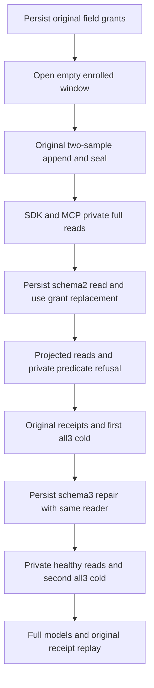

# Current resource tag policy over enrolled chunk reads

Owning TimeSeries extension to [ResourceTagPolicyPublic](ResourceTagPolicyPublic.md) and [TimeSeries](../TimeSeries.md), under ADR-120 and the enrolled chunk contract. This scenario extends AC-SERIES-RESOURCE-TAG-POLICY-001/002 and AC-SERIES-CHUNK-010/012. It adds no public API, provider, trusted principal, schema migration, deadline, topology or test declaration.

REQ-SERIES-RESOURCE-CHUNK-POLICY-001: the original public resource-policy scenario enrolls one empty half-open chunk before its original append, preserving that original command GUID, two independently literal samples and original receipt. Separate original open/seal GUIDs retain complete receipts. Open revision1 plus two accepted samples gives revision3; explicit seal gives revision4, generation1, sourceSequence2 and null retention floor. Until=MaxValue prevents automatic sealing of an already elapsed fixture window. Every expected record, timestamp, value, sequence, tag, interval and watermark is authored independently. Each returned CutPosition must be positive and remains an opaque observation coordinate.

REQ-SERIES-RESOURCE-CHUNK-POLICY-002: the same persisted SeriesRead subject/key/epoch initially has the original SecretGrant. The authored initial resource policy explicitly assigns that grant to both RawReadGrant and RawUseGrant; the native default pii.use is not silently assumed present. Schema2 changes both grants to ChangedGrant and schema3 restores both. Other fields and the original write grant remain unchanged. SDK and official MCP unfiltered reads return complete private tags at schemas1/3 and complete projected tags at schema2. The private equality predicate succeeds at schemas1/3 but returns PermissionDenied at schema2 before pruning, with no partial result or private-value disclosure. SDK compares the complete Errors.Problem(PermissionDenied, fixed native field-use message), not a fabricated exception or copied actual oracle. This extends the original raw-read-only fixture contract while retaining all its original expected raw/latest/aggregate results and schema-CAS behavior.

AC-SERIES-RESOURCE-CHUNK-POLICY-001: SAME original TimeSeriesResourceTagPolicyClusterTests.CurrentResourceTagPolicyChangesProjectAndRestoreSameReaderAcrossReplayAndTwoColdCycles executes initial private SDK/MCP chunk reads, replacement projection and both private-predicate refusals, fresh repair and same-reader healthy reads. Every chunk response/replay/refusal uses an ordered primary-failure ledger, then unconditionally observes complete administrator raw rows, chunk metadata/rows and outbox before rethrow. The existing canonical and new chunk administrator checks are both observed even if one fails. Public conservation is precisely those exposed models; it does not prove raw physical bytes, one common cross-call cut, or global memory stability.

AC-SERIES-RESOURCE-CHUNK-POLICY-002: SDK/MCP replay the original open/seal full receipts without altering samples, enrolled generation/revision/source watermark or outbox. Existing original append/configuration success and stale-CAS failed receipts remain unchanged. The existing Trial closes original caller scopes before each genuine all-three-owner cold wave, opens authenticated SDK/official MCP clients at discovered endpoints, and repeats current policy, model, replay and healthy observations through both cold cycles. Existing bounds/cancellation/public257 cases are controls; this extension does not replace them.

Exact source ownership: existing TimeSeriesResourceTagPolicyClusterSeed/State/Assertions/Policy/Trial; new TimeSeriesResourceChunkPolicyClusterEnrollment/Read/Refusal. Original Cases/TimeSeriesResourceTagPolicyClusterTests and its declarations remain untouched. Root is the integration and SDK/runtime owner. TimeSeries parent document and retained-window paths remain owned by the independent Unit strand. Frontend N/A: no UI operation exists here.

Native existing compound preview, exact qualified new-role absence and creation-NotSupported evidence are retained with the source packet; they are not compiler or runtime proof. OPEN gates: compiler; current whole-case runtime; required exact-source Linux cluster; fault/endurance/performance. Existing SDK/MCP admission, bounded cancellation and retained receipt cases remain required independent controls. No universal coordinate relation is claimed.
