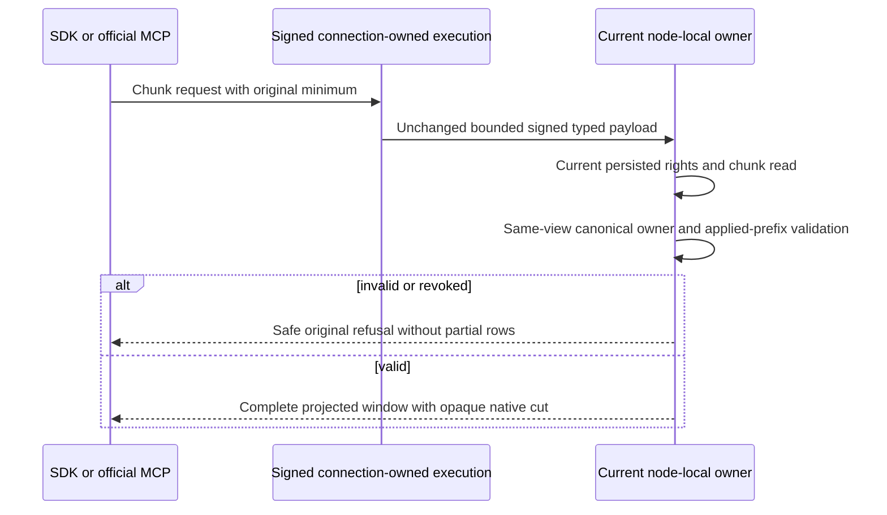

# Explicit minimum consistency for enrolled chunk reads

This contract extends AC-SERIES-CHUNK-010/012 and the existing session consistency contract. Native direct SDK/official MCP, signed connection-owned CQRS, node-local ZoneTree read gate and current RF3 quorum remain mandatory. Owning decisions are ADR-120 and ADR-125; this specification adds no library, dispatcher or physical storage format.

REQ-SERIES-CHUNK-MINIMUM-001: append ONLY nullable CommitToken MinimumToken at stable generated Orleans field Id7 to ReadSampleChunkWindowRequest. Retain original alias and Id0..6, constructor shape, default null, request/result routes and read kind. Existing null requests preserve ordinary current read behavior. No out-of-band envelope field, client role, synthesized owner token, SQL rewrite, global cache or new dispatcher is allowed.

REQ-SERIES-CHUNK-MINIMUM-002: one original charged Store.Read owns current persisted principal/resource/field-use checks, enrolled generation integrity/row projection and requested minimum validation. Preserve the existing reader's validation/authentication/budget/cancellation/error precedence. Before publishing a successful result, a nonnull token is checked using the existing DatabaseEngine.ValidateDocumentSessionToken against the SAME bounded view. It must match the resolved canonical physical-owner incarnation, atomic partition and current placement epoch, have a positive position and not exceed the view's authentic applied replica-prefix marker. Caller tokens are fencing assertions, not credentials. Fresh forbidden tag use fails before token validation. The original budget checks bracket new validation work; no duration/resource limit increases, waits, retries, decode fallback or partial response are introduced.

The validator reads canonical physical-owner catalog/placement; it does not compare to a node-local Store.Identity GUID or to SampleChunkWindowResult.CutPosition. MinimumToken.Position is an applied replica prefix; returned CutPosition remains an opaque native transaction coordinate. Token matching cannot be inferred from an inequality between those spaces. Normal signed native payload bytes include the optional field and are bound by existing request encoding/signing/validation; no parallel signature input is added. Full native body/cache/key/budget closure must be demonstrated before qualification.

AC-SERIES-CHUNK-MINIMUM-001: real-store operations validate an authentic acknowledged minimum, exact wrong incarnation/foreign atomic partition/stale placement epoch/nonpositive/future prefix refusals with no partial result and complete raw-image/cut conservation. Preserve current permission and private field-use denial before a deliberately invalid token, then genuine grant repair/healthy same-store operation. Original success receipts replay unchanged. No getter/property-only test substitutes for reads against native state.

AC-SERIES-CHUNK-MINIMUM-002: real SDK and official MCP receive the exact original acknowledged token from an independently checked full command receipt, send it in the typed request from different actual RF3 voters, and return independently literal complete chunk identity/generation/revision/sourceSequence/floor/records. Both original and invalid requests run under unconditional public rows/chunk/outbox/placement conservation. A persisted capability revoke refuses before invalid token inspection; fresh repair permits the same original valid minimum. Each fresh caller uses verified persisted subject and unchanged token/deadline.

AC-SERIES-CHUNK-MINIMUM-003: the original minimum remains valid after the first authentic same-owner all-three cold cycle. A genuine distinct physical-owner movement invalidates the original incarnation/epoch assertion on SDK/MCP; fresh target-owner command returns an independently checked target token and same-owner healthy chunk read. Original command receipt replay remains byte exact despite movement and never silently rewrites its token. Source/target/routing/current authorization and full models are checked; all original callers settle before owned process/reader/lock shutdown. No administrative fixture discovery is advertised as nonadmin automatic routing discovery.

Existing document cross-voter source proof resolves the token against canonical PhysicalShardRecord incarnation/voters through current placement; it never substitutes node-local identity. Actual runtime interoperability remains OPEN. OPEN until actual closure: full signed-payload/cache/budget/native dispatch path; exact native previews; compiler and current complete Unit/public/movement runtime; Linux RF3, fault, recovery, endurance and performance. No library, migration, fallback or universal consistency claim follows from source review.
