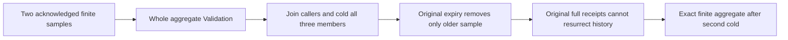

# TimeSeries finite-overflow public continuation

Public acceptance flow under ADR-052/073/117/125 and parent REQ/AC-SERIES-009/011/012/013/014. Existing TimeSeriesRf3AuthorizationTests retains its warm overflow-code/latest-ID/other-series follow-up. This stage adds the same affected series' complete independently literal public state, overflowing first cold and actual retention repair, original acknowledged command replays and repaired second cold; it does not replace that original case.

| Requirement | Acceptance | Automated mapping |
|---|---|---|
| REQ-SERIES-OVERFLOW-PUBLIC-001 preserve finite canonical samples through a refused aggregate | AC-SERIES-OVERFLOW-PUBLIC-001 two distinct acknowledged double.MaxValue samples remain exact ordered complete SampleRecord rows; whole aggregate refuses typed Validation, each SDK/MCP refusal is immediately followed by complete administrator raw/latest/retention/outbox controls and a healthy one-sample aggregate | SeriesFiniteOverflowPublicTests + Checks/Observation |
| REQ-SERIES-OVERFLOW-PUBLIC-002 retain failure and healthy narrow reads after actual cold | AC-SERIES-OVERFLOW-PUBLIC-002 join all original callers, restart all three same-volume Aspire-owned members, open fresh same-credential SDK/official MCP callers; same affected aggregate still refuses and full current state/original seed receipt remain exact | Trial + existing CredentialAuthorityCold |
| REQ-SERIES-OVERFLOW-PUBLIC-003 repair using the actual monotone retained-sample contract | AC-SERIES-OVERFLOW-PUBLIC-003 one original ExpireSamples command advances the floor to the second timestamp and deletes only the first sample; full receipt has literal cumulative purge count1, remaining original sequence2 survives, whole aggregate now equals literal count1/sum/min/max/average double.MaxValue; old seed receipt replay cannot resurrect the expired row | Preparation/Trial/Expected |
| REQ-SERIES-OVERFLOW-PUBLIC-004 preserve full receipts and repaired state after the second cold | AC-SERIES-OVERFLOW-PUBLIC-004 SDK and official MCP original seed/expiry replays match their entire captured acknowledged receipts, each separately followed by full current controls/healthy exact aggregate; second joined all-three cold with fresh original credentials retains every independent result | Trial/Checks |

| REQ-SERIES-OVERFLOW-PUBLIC-005 isolate finite per-window aggregation and preserve dense requested origins after retention | AC-SERIES-OVERFLOW-PUBLIC-005 same two finite MaxValue samples return two exact one-tick windows while a wider window refuses complete Validation/no Value; each route receives full current controls and each refusal the healthy windows. First all-three cold preserves failure and finite controls. Expiry creates a literal empty first window plus original sequence2 finite second window and healthy wider window; each SDK/MCP original full receipt replay and second all-three cold preserve the entire dense result. | Same original Case + WindowChecks/Expected/Observation/Trial |

Canonical map: IntegrationTests/Features/TimeSeries/Cases/SeriesFiniteOverflowPublicTests.cs; Models/SeriesFiniteOverflowPublicState.cs; Helpers/SeriesFiniteOverflowPublicPreparation.cs, SeriesFiniteOverflowPublicObservation.cs, SeriesFiniteOverflowPublicTrial.cs; Assertions/SeriesFiniteOverflowPublicExpected.cs, SeriesFiniteOverflowPublicChecks.cs and SeriesFiniteOverflowPublicWindowChecks.cs. Durable spec target docs/Features/TimeSeries/FiniteOverflowPublic.md. Backend/contracts/SDK/MCP server/frontend N/A: this acceptance-only flow exercises existing product operations and adds no product surface.

Errors: SDK code/status/type/title/detail and absent success value are independently checked using Errors.Problem(Validation, "The time-series aggregate is not finite."). Official MCP uses its existing complete dispatched-error assertion and its own safe transport detail; each refused route immediately receives the full healthy/current controls. No scalar/off switch, tolerance, synthetic nonfinite sample, alternate arithmetic library, raw fault, new clock/deadline/budget/API/format/dispatcher or provider. Each input and healthy expected result is finite. This is not a performance measurement.

Window aggregation initializes a separate accumulator for each bucket. Retention clips the sample scan while window origins remain the requested range, including empty windows. Independent full expected window DTOs use exact finite arithmetic without tolerance and do not call the production accumulator. The code for this flow is authored; solution compilation, formatting, native test census, SDK/official MCP RF3 execution, exact-source Linux, recovery, fault, endurance and performance qualification remain pending. Separate public routed calls do not prove a correlated node-local native image or physical cut; no CommitToken position equality is asserted.

REQ-SERIES-OVERFLOW-PUBLIC-006 / AC-SERIES-OVERFLOW-PUBLIC-006: exact actual closed official MCP safe detail is independently checked for both ordinary and wider-window overflow: dispatched Validation, absent success value through ErrorAsync and "The database operation could not be completed." through StructuredContent. Observation owns the shared assertion; per-response full current controls and genuine finite controls remain at both original call sites. No arbitrary domain detail is reflected. The complete operation flow, same no-Args Case and deadline, genuine retention repair and two joined cold stages are preserved. The code is authored; compiler and runtime qualification, including exact-source Linux RF3, remain pending.
