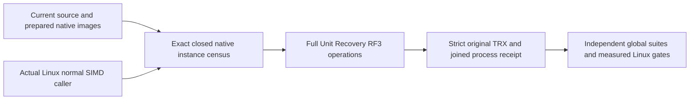

# KL078 Linux whole-operation qualification binding

This child contract maps architecture §27.6/KL078, ADR079 and ADR124 plus AC-CHUNK-001..006 and AC-SERIES-CHUNK-007..012. Historical scalar receipts remain history. Current qualification admits only normal hardware-enabled Linux execution, original .NET10 source/DLL/PDB/image identities, native TUnit discovery, all exact declared instances, complete passing TRX and joined original processes. No source packet or historical census is a current PASS.

The three closed full-class selections bind codec/wire/native payload/canonical lifecycle, raw reader and aggregate oracles, cancellation/resource bounds, corrupted selected representation/repair, mixed rollback, corrections and paged retention; real process Open/Append/Correction/Seal/Merge and two-block publication cuts; genuine Aspire RF3 SDK/official MCP/native SQL lifecycle/current-policy/retention/rollup/subnormal/multiblock/scheduler overload/uncertainty/cold flows. Exact case identities derive from original retained census, never generated UIDs or future guessed counts. The executor independently discovers current instances against the same prepared source-bound image and refuses missing/extra/duplicate/DGE cases before execution. Every original case remains selected in its complete class.

REQ-KL078-LINUX-BIND-001 / AC-KL078-LINUX-BIND-001 require exact full workflow choice+matrix/contract/producer/verifier coherence. The all-task workflow includes KL078; explicit KL078 runs do not imply full solution-suite qualification. Existing maximum-parallel50, original timeouts/framing/admission/caller cleanup and source-after verification remain unchanged.

REQ-KL078-HARDWARE-001 / AC-KL078-HARDWARE-001 capture actual Linux caller architecture/runtime/vector acceleration and all four native SIMD environment controls before original discovery/execution. Verify actual current Linux host values independently and refuse disabled/noncanonical controls. This is host admission/provenance, not proof that every chunk codec instruction is vectorized or a performance measurement; original complete database operations and native child source-image checks are mandatory.

The functional task receipt remains task-scoped. Full KL078 additionally requires exact-source complete global Unit/Recovery/RF3 gates and authenticated Linux measurements of bytes/sample, rewrite cost and allocation at the canonical100000/1000000 actual-record scales with applicable100000 measured operations, equivalent previous-code/native raw baseline, matched durability/topology/corpus/limits, original successful complete outputs and retained source/runtime/hardware/profiler provenance. Fixed1/32/256 codec BDN controls, method presence, a caller hardware flag or process kill cannot supply those measurements, acceleration, power-loss or endurance qualification. Missing measurement/fault/endurance evidence stays OPEN in canonical status; this new CI task binding does not silently close it.

