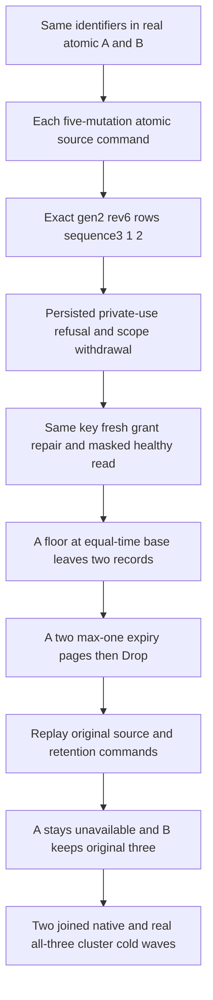

# Partition-scoped chunk lifecycle qualification

REQ-SERIES-017..020 / AC-CHUNK-001..006 and REQ/AC-SERIES-CHUNK-007/008/010/011/012; ADR-005, ADR-010, ADR-014, ADR-079, ADR-116 and ADR-124. This whole operation is a source candidate. Broader chunk lifecycle and exact-source execution/performance acceptance remain OPEN.

## Native contract and selected source

Canonical chunk storage belongs to node-local ZoneTree and generated Orleans native records. SampleChunkKeys uses the actual complete KeySpace.Partition identity, including PartitionKey. PartitionRef.AtomicPartitionId is a derived hash, not an assignable fixture counter. The new operation changes only the genuine sibling PartitionKey, asserts distinct computed atomic identities and otherwise reuses the same tenant/database/domain/set/series/window/sample IDs. It does not label those logical identities as replica members.

The centrally pinned ManagedCode.TimeSeries10.1.2 is the existing published aggregation dependency. The actual cached nupkg/nuspec identifies owning repository https://github.com/managedcode/TimeSeries, MIT license and package source commit75c6d5d75efe6e288fdd9fe13fc2dc9f8d0fcaf8. Its DoubleTimeSeriesSummer is called by the existing Core SampleAggregateAccumulator. This batch changes no library, package, scalar/SIMD path or library implementation; no dependency defect is confirmed. Immutable package/DLL hashes and current adapter source bindings are retained in the ready packet. Source presence and a cached package are not fresh publication, runtime or performance proof.

| Requirement | Acceptance and actual whole operation |
| --- | --- |
| REQ-TSCQ-001: complete identity scopes raw, immutable generation and correction records | AC-TSCQ-001: two real atomic partitions accept the SAME WindowId/SeriesId/EventIds with independently different values/tags/offsets. Each authentic five-mutation Batch performs Open→Append first sample (native due-window auto-seal)→Append equal-UTC second correction→Append earlier-time correction→Merge, leaving generation2/revision6/source3 and exact UTC/sequence order3,1,2. There is no pending correction after publication, so no chunk-worker flush or invented background outcome. |
| REQ-TSCQ-002: lossless records and native aggregates agree at explicit boundaries | AC-TSCQ-002: all original local/UTC timestamps, +05:45/-03:30 original offsets and +14/-14 correction offsets, sample IDs/sequences/TagsJson and IEEE positive/negative zero bits survive both representations. Raw/latest and published-library raw/dense-window aggregate results have independent complete literal values. Public SDK, official MCP and existing unified SQL EXEC routes return the same complete contracts. |
| REQ-TSCQ-003: retention/drop and retry cannot cross the atomic partition | AC-TSCQ-003: only primaryA advances floor to the equal-UTC base, removing its earlier correction; then two genuine maximum-one deletion pages advance the floor to Until with exact cumulative1/2/3 and HasMore false/true/false. Sealed immutable generation remains selected while filtering floor; Drop advances revision7 and returns HistoryUnavailable. B retains all3 exact original records/generation/source/floor. Original A lifecycle command replay after Drop cannot resurrect a window/records, and original B replay cannot alter either scope. |
| REQ-TSCQ-004: current authority, bounded cancellation and cleanup remain real | AC-TSCQ-004: same persisted reader/key starts with private tags masked and protected tag-use refusal; current scope withdrawal denies before models, genuine epoch3 repair allows the private beta predicate while still masking its output. Native and official MCP original pre-cancel tasks retain OCE/token; SDK typed read returns full Cancelled read-unavailable Problem and null. The complete selected-record limit2 refuses B’s genuine3 records with full BudgetExceeded/null output across the actual routes; healthy limit3 and unchanged original reads/replays follow. Both native same-root cold attempts and both all-three Aspire cold attempts are independently joined. |
| REQ-TSCQ-005: full conservation is independent of replay receipt equality | AC-TSCQ-005: native all eight sibling raw/chunk family bytes are frozen after the successful independent baseline and remain unchanged across every observed wave. Every original source/expiry/drop receipt is independently authored natively with all five mutation fields and actual persisted outcome bytes. All five public receipt fields and all three token fields are checked against independent operation intent, including the actual persisted-copy acknowledgement; full current records and outboxes are checked after EACH SDK and MCP original replay. Public hidden CompositionReferences is unobservable JsonIgnored data; it is proved only natively. |

The corpus uses UTC2001 so the existing actual admitted-clock retention predicate Before<=now remains valid; there is no fake clock or production seam. The correction sorts BEFORE the original equal-time pair, so merge must preserve negative sequence delta and the original offset/value bits. A initial aggregate is count3/sum6/min-negative-zero/max4/average2, partial count2/sum6/min2/max4/average3 and expired empty. B remains count3/sum-12/min-8/max-positive-zero/average-4. Public physical cuts remain positive and opaque across fresh calls; no logical receipt/local cut comparison is permitted.

Native contributor: TimeSeriesChunkQualificationWholeFlowTests.SameWindowAndSampleIdentitiesStayPartitionScopedAfterRetentionDropReplayAndTwoCold. TestDatabase owns one real canonical ZoneTree store. Its ordinary submission creates a native `Command<DatabaseCommand>` and executes Core ApplyEmbedded; explicit business-time submissions use Core Apply. Expected receipt positions come from the independently observed precommit canonical AppliedPosition plus one. The native receipt requires ProcessDurable and exactly one persisted copy; the physical Store.Position remains a separate observation. Reads and every replay retain whole native image/physical position/identity conservation, unchanged actual outcome bytes and complete independent current row/retention/aggregate oracles. B's frozen eight-family bytes distinguish alias isolation from merely comparing a window ID. Every cold store is disposed before original fixture resource deletion; complete acquired-owner bodies include initialization/native factory failures before disposal observers. Current-source compilation, declaration discovery and execution remain open until their original reports exist.

Public contributor: TimeSeriesChunkQualificationClusterTests.SameChunkIdentityAcrossAtomicPartitionsKeepsExactValuesOnRetentionDropReplayAndTwoCold. The actual fixture owns Aspire cluster startup/readiness/runtime/shutdown, the official SDK transports and same-root restarts. Chunk/raw/latest/aggregate/dense-window/retention each execute native .NET SDK, official MCP and existing unified SQL SDK/MCP operations. Primary outbox source count5 advances6/7/8/9 only through its three expiry commands and Drop; B remains5. Each complete status baseline is captured only after the genuine intended write with independent literal head/record counts, then preserved through read/replay observers. Pure current-image helpers never recurse into replay. Real caller resources settle before the original ModelSqlClusterCold node restart helper. Default deadlines, limits and all three resources remain unchanged.

The original SampleChunkClusterAssertions.CompleteAsync loses only its invalid physicalCut>=logicalReceiptPosition assertion. It now validates positive opaque cut and the acknowledged token's atomic scope while retaining every existing complete merged window/row golden. That scope assertion alone is not a causal-read proof. Original merge polling, original seal receipt replay, privacy and cold caller order remain unchanged. No product API, operation, alias, field ID, parser, schema, timeout or format changes.

## Open qualification

Prepared source/native readonly syntax/numeric/nesting checks are distinct from independent full source/API peer, Root canonical formatting/semantic compilation, actual declaration discovery, complete Unit, real process recovery, Docker/Aspire cluster and delivered exact-source Linux gates. The two planned declarations are not discovered/passed evidence. Native one-owner scoping is not cluster, and process kill is not power-loss proof. Existing full codec/256/257/multiblock, corruption/repair, mixed-model rollback, subnormal/extrema, chunk-worker/creator revocation and process publication suites remain mandatory. Comparable Linux bytes/sample, rewrite cost, allocation, endurance and performance measurements remain OPEN; no source review or this small functional corpus can promote them. No legacy fallback, migration, stored-authority bypass, new library, local benchmark or speed claim is introduced. UI N/A: database operation qualification.

## Historical-window producer

The fixed2001 sample window is already past Until at the actual current native evaluation time. SampleChunkAppendOwner increments the first appended record revision from1 to2 and performs its existing due-window automatic seal to revision3/generation1. The equal-UTC second record is a correction at revision4; the earlier-time third record is a correction at revision5; Merge(expected5) publishes the exact original revision6/generation2/sourceSequence3. The complete five-mutation command now appends each initial sample separately instead of issuing an invalid explicit Seal(expected3) after a window which has already sealed. Empty explicit Seal is not a legal alternative. This operation qualifies its genuine automatic-seal path; the existing explicit-seal lifecycle suites remain separately mandatory and are not replaced by this fixture.

Native and public fixtures use this same canonical producer. Five receipts are independently fixed as open1, append1, append2, append3, merge6: append receipts describe source sequence, not window revision. The outbox still has exactly five seed mutations. No sample ID, timestamp, UTC/local offset, negative-zero bit, tag, window identity/bound, final merged image, retention/drop, current grants, minimum forwarding, original replays, cold count, resource limit or deadline changes. It does not suppress the actual revision precondition or change the chunk implementation, clock, scheduler or dependency.
