# Public correction-only chunk tag admission

This child specification owns one missing public acceptance slice of original KL078, REQ/AC-SERIES-CHUNK-008/009/010/012. Native Unit correction-only-tag controls and existing RF3 maintenance/revocation controls remain unchanged and separately required. No production defect or runtime result is claimed by this source packet.

## Exact operation and independent oracle

`SampleChunkCorrectionPredicateRf3Tests.CorrectionOnlyTagHitMissAndWholeLimitRefusalSurviveNativeMergeReplayAndTwoColdOwners` starts the existing fixture-owned six-node/two-RF3-group Aspire wave and waits for all actual nodes. The unchanged native creator fixture persists the real principal, credential and series. That creator opens the real window, appends equal-UTC rows with values2/4 and alternate offset, then seals the original generation with visible17 tags.

Before a genuine late signed-zero append with visible23, the fixture arms the existing original merge identity at AuthorizationReload. The actual native Durable Job reaches that exact marker and holds before original authorization/commit. The first complete expected generation is g1/r5/source3; the base inventory has no visible23, while the real correction does. This is an observation/control of the original producer, not a synthetic worker, provider or scheduling replacement.

| Criterion | Complete public oracle |
| --- | --- |
| Correction-only candidate | SDK and official MCP `/visible=23`, Limit1 return exactly the original late signed-zero record/sequence3, exact tags, native window bounds, floor absence and generation/revision/source. |
| Predicate miss | `/visible=99`, Limit1 returns the complete same header and no records. |
| Complete result bound | Unfiltered Limit1 returns complete BudgetExceeded and no SDK result; official MCP returns the exact safe problem without secret/tag disclosure. No partial prefix is accepted. |
| Conservation after every selected response | Regardless of a primary assertion failure, complete chunk/raw/latest/aggregate/windows/retention reads and the entire scoped outbox status are checked. Independent literal raw values are2/4/-0, sequences1/2/3, aggregate count3/sum6/min-0/max4/average2, absent floor. The four legitimate mutations produce tail/stored count4 with first1, positive stored bytes and no consumers. |
| Actual healthy transition | Release and join the exact original request's Released and ProducerDisposed markers, retire the original arm, then observe the actual scheduled merge g2/r6/source3. All rows and predicates remain exact; the one legitimate merge advances outbox count to5. |
| Replay and cold | Both callers replay the actual original seal and correction command GUID/body and compare their complete retained receipts. Conservation follows each replay. Two joined same-volume cold owner cycles retain the exact complete result, signed-zero bits, original receipts and full stable outbox status. |

The real creator executes the correction; only the real administrator reads placement and full outbox metadata. Existing current persisted authorization, native request execution, signed discovery and original parent deadline remain in force. Physical CutPosition must be positive; it is never compared with a potentially different receipt coordinate. Expected dynamic window bounds come from the originally chosen public window, not from the returned result. Receipt positions are retained original observations; fixed receipt command/identity/epoch/mutation/durability fields are checked against the existing native placement contract before replay.

## Scope, ownership and qualification

Only six new TimeSeries Integration roles and this child specification are selected. Product, Core format/options, shared ClusterFixture, native jobs/provider, host/lifecycle, test transport, SIMD and libraries remain unchanged. Backend/frontend changes are N/A: this is public operation qualification of the existing implementation. SDK/MCP and infrastructure reuse existing native surfaces; no public route or compatibility mode is introduced.

The existing TwoRf3MembershipWave and RequestCqrsRf3Callers own all actual startup, clients, worker settlement, process shutdown and root retention. The whole body and each response/conservation pair preserve independent failures through the existing failure ledger. A failing held stage still attempts original control release and then joins owned wave shutdown. No fake close failure or no-op disposal is accepted as release proof.

Cached Roslyn numeric/nesting preflight and source peer review do not establish compiler or runtime acceptance. Strict build, actual discovered UID/selector and local-image admission, original SDK/MCP RF3 execution, required Linux/recovery suites, process interruption, scale/performance and whole KL078 completion remain OPEN. Root owns canonical selector/image admission and execution; no inventory count is invented here.

```mermaid
flowchart LR
  Seed[Actual creator open append seal visible17] --> Arm[Arm original native merge observation]
  Arm --> Late[Actual visible23 correction]
  Late --> Held[Observed original producer g1 r5]
  Held --> Reads[SDK and MCP hit miss whole-limit refusal]
  Reads --> Release[Release and join same original producer]
  Release --> Merge[Actual scheduled merge g2 r6]
  Merge --> Replay[Full models outbox original receipt replay]
  Replay --> Cold[Two joined same-volume cold cycles]
```

