# Public subnormal sample fidelity through original cluster owners

This packet extends the canonical
[TimeSeries requirements](../TimeSeries.md), REQ/AC-SERIES-CHUNK-007/010/012,
and the native lifecycle in [ADR-124](../../ADR/ADR-124-native-time-series-chunks.md).
The existing 2, 4 and negative-zero corpus, original declarations and UIDs stay
unchanged. The distinct public workflow uses the smallest positive and negative
finite nonzero binary64 values in a fresh real configured partition, retains
the original alternate timestamp offset, explicitly seals its native window,
adds the original negative-zero correction, and waits for genuine native merge.

## Requirements and acceptance

| Requirement | Measurable acceptance | Original real operation proof |
|---|---|---|
| REQ-SERIES-PUBLIC-SUBNORMAL-001 | AC-SERIES-PUBLIC-SUBNORMAL-001: publish double.Epsilon and -double.Epsilon, not the earlier 2/4 samples, through the SDK; the complete independent SampleRecord array retains exact series, sample ID, original UTC/offset, sequence and private tags. Complete direct SDK, official MCP, current SQL SDK and SQL MCP raw reads must equal that array. A rounded zero, lost sign, omitted field, reordered or duplicate row fails. | Fresh TimeSeriesClusterScenario configuration, explicit Open command, the new Corpus.First/Equal Append command, and all four existing ReadOracle routes. |
| REQ-SERIES-PUBLIC-SUBNORMAL-002 | AC-SERIES-PUBLIC-SUBNORMAL-002: the original explicit seal produces generation1/revision4/source2; the original negative-zero correction and real native merge produce generation2/revision6/source3. Complete window and raw DTOs, minimum acknowledged cut and full independently fixed mutation/token/durability receipts are mandatory. | Seal command, complete pre-correction reads, late Append command, actual WaitForActualMergeAsync, and complete merged reads. |
| REQ-SERIES-PUBLIC-SUBNORMAL-003 | AC-SERIES-PUBLIC-SUBNORMAL-003: each of the four original command GUID replays returns its complete original receipt through SDK and official MCP; full current merged window and raw rows are rechecked after EACH individual replay. Both genuine all-three-node cold cycles retain these outcomes and create fresh public callers after readiness. | Replay helper, original Aspire Kill→BeginRestart→Restart→Healthy operations, and identical full four-route read oracles after each replay and each cold. |
| REQ-SERIES-PUBLIC-SUBNORMAL-004 | AC-SERIES-PUBLIC-SUBNORMAL-004: after both cold cycles a fresh independent series append receives its exact original full receipt and full four-route raw result, while the old merged window/corpus still passes at the newer acknowledged cut; replaying every old command still cannot duplicate old or healthy rows. Every original action/MCP/HTTP/deadline cleanup failure is retained before the next enclosing owner disposes. | Fresh native EmptySeries append, complete read/replay checks, nested ServerFailureObserver ledgers, and the test fixture's existing owned shutdown. |

One native TUnit Case, SampleChunkSubnormalClusterTests.
AcSeriesPublicSubnormal001004SealMergeReplayAndTwoColdKeepExactPublicSamples,
maps to all four criteria. It uses the existing sample-chunk-native-cold keyed
ClusterFixture, existing NotInParallel shared-resource invariant, existing
McpCallerDeadline and existing output/read bounds. No new timeout, retry, clock,
provider, network, scalar execution profile, test seam or serializer is added.
All original current-time selection and merge polling are reused from the
actual existing composition/native contracts. Actual generated UID/census,
deadline fit, native admission, compiler and complete Linux cluster outcomes remain
OPEN until the integration owner runs them; this source packet proves none.

## Scope, boundaries and execution

ADR: N/A for a new architecture decision. Existing
[ADR-079](../../ADR/ADR-079-lossless-series-chunk-codecs.md),
[ADR-124](../../ADR/ADR-124-native-time-series-chunks.md),
[ADR-117](../../ADR/ADR-117-native-tunit-ci-entry.md) and
[ADR-125](../../ADR/ADR-125-connection-owned-execution.md) define the lossless
codec, node-local native chunk ownership/cluster, actual TUnit/Aspire lifecycle
and connection-owned public execution. This changes acceptance
coverage only, with zero product, public API, persisted format/alias/field ID,
credential/permission, SQL dialect, dependency, UI or benchmark changes.

Canonical slice map: feature-local Helpers own corpus, seed, replay, callers,
cold and ordered flow; Models owns immutable original commands/receipts;
Assertions owns complete result and receipt oracles; Cases owns the single
native declaration. The existing SDK, official MCP, current SQL helper and
TimeSeries factories/protocols remain shared native dependencies. Other
product/UI surfaces are N/A because this is a qualification extension.

Order: fresh actual configuration → explicit Open
→ actual subnormal Append → complete raw reads → explicit Seal and complete
sealed reads → actual negative-zero Append and native merge → complete merged
reads → individual full historical receipt replays → join original callers
→ all-three cold1 and complete fresh-caller checks/replays → join → all-three
cold2 and identical checks/replays → fresh healthy series append and complete
old/new results, receipt replay and final joined cleanup.

Baseline: existing native source proves 2/4/-0 coverage; no runtime defect is
claimed and no local/CI result is invented. Unexpected operation failure is a
test failure retained by the original ledger; disposal cannot replace it.
No runtime rejection semantics or data migration is introduced. Rollback is
removal of this new test/spec packet before acceptance; no data format changes.
The original mandatory whole solution, native SIMD unit/recovery/cluster and
exact-source Linux gates remain required. This focused Case is not whole-task,
coverage, power-loss, endurance, performance or production-readiness proof.

```mermaid
flowchart LR
    Fresh[Fresh actual configured partition] --> Append[SDK publishes positive and negative subnormal samples]
    Append --> Seal[Explicit native seal and full reads]
    Seal --> Merge[Negative zero correction and actual merge]
    Merge --> Replay[Original SDK and MCP receipt replays with full results]
    Replay --> Join[Join every original caller]
    Join --> Cold1[Original all-three cold1]
    Cold1 --> Cold2[Original all-three cold2]
    Cold2 --> Healthy[Fresh healthy append and complete old plus new results]
```

