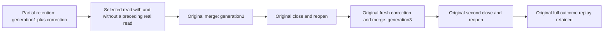

# Retained chunk reads share one operation

Canonical slice: TimeSeries. Target: docs/Features/TimeSeries/RetainedChunkReadBudgets.md.

This extends existing REQ-SERIES-018 / AC-CHUNK-003, REQ/AC-SERIES-CHUNK-008/010/011/012 and REQ-MP-002 / AC-MP-005. The existing partial-retention case, UID, storage owner, monotone clock, normal SIMD path, command sequence, complete outcome replay and both same-directory close/reopen boundaries remain intact. A selected retained-history read runs under one `ReadExecutionBudget` and its view: the budget carries the operation's cancellation and explicit expiry and counts no read bytes or records ([ADR-149](../../ADR/ADR-149-no-operation-limits.md)).

| Requirement | Acceptance criterion and automated owner |
| --- | --- |
| REQ-SERIES-RETAINED-BUDGET-001: selected retained immutable history is read through the operation's own view before decoding or projection | AC-SERIES-RETAINED-BUDGET-001: the original partial-retention flow exercises generation1 plus correction, merged generation2 and fresh generation3 while expired base records remain encoded. Independent complete window results retain exact window identity, UTC bounds, generation/revision/source sequence, floor, visible rows/tags/offsets/IEEE values and source cut. Existing canonical/raw/manifest/block/digest oracles remain unchanged. |
| REQ-SERIES-RETAINED-BUDGET-002: preceding real work in the same operation does not change the result | AC-SERIES-RETAINED-BUDGET-002: read the actual enrolled window key through the same original budget before the selected-reader call; the read returns the same full independent result as the read without it. The budget is not renewed during decode or projection. |
| REQ-SERIES-RETAINED-BUDGET-003: reads have no database effects and healthy work follows both cold owners | AC-SERIES-RETAINED-BUDGET-003: every read leaves the complete ordered image, identity and cut unchanged; invoke the original full healthy oracles after each read. Repeat the checks at both original cold checkpoints. Original successful/failed command outcomes and immutable generation checks continue unchanged. |

Automated owner: SampleChunkPartialRetentionTests.AcChunk008011012PartialFloorMergePreservesEncodedHistoryAndExactReplayAcrossTwoColdOwners through its original SampleChunkPartialRetentionFlow, with the feature-local SampleChunkRetainedBudgetTrial and independent expected-result roles. No new Test, Arguments, UID, fixture, clock, storage format, product configuration or deadline is introduced. Each trial read uses one existing owner/store cut and one original ReadExecutionBudget/CreateView. Public default entry and original public/healthy oracles remain required.

Backend production code: N/A, the current budget/view contract is sufficient. SDK, official MCP, frontend and transport changes: N/A for this scoped Unit extension; their cluster and public acceptance gates remain independently mandatory. Benchmark/performance change: N/A, no speed, allocation, scalability or power-loss claim follows from these reads. Compiler, formatter, Aspire-owned TUnit, process recovery, Docker cluster, Linux CI and performance gates remain pending until exact source-bound original results qualify them.
