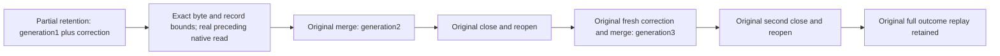

# Retained chunk reads retain the original operation budget

Canonical slice: TimeSeries. Target: docs/Features/TimeSeries/RetainedChunkReadBudgets.md.

This extends existing REQ-SERIES-018 / AC-CHUNK-003, REQ/AC-SERIES-CHUNK-008/010/011/012 and REQ-MP-002 / AC-MP-005. The existing partial-retention case, UID, native storage owner, monotone clock, normal SIMD path, command sequence, complete outcome replay and both same-directory close/reopen boundaries remain intact. The current product entry already creates its view and read grant from its original budget; no production budget defect or new product limit is claimed.

| Requirement | Acceptance criterion and automated owner |
| --- | --- |
| REQ-KL078-BUDGET-R45-001: selected retained immutable history obeys the operation budget before decoding or projection | AC-KL078-BUDGET-R45-001: the original partial-retention flow exercises generation1 plus correction, merged generation2 and fresh generation3 while expired base records remain encoded. Independent complete window results retain exact window identity, UTC bounds, generation/revision/source sequence, floor, visible rows/tags/offsets/IEEE values and source cut. Existing canonical/raw/manifest/block/digest oracles remain unchanged. |
| REQ-KL078-BUDGET-R45-002: byte and native record work remain distinct and cumulative | AC-KL078-BUDGET-R45-002: measure actual accepted logical key/value bytes and native examined records from the original budgeted view, independently of visible/decoded sample counts. The exact measured byte/record boundary succeeds; one less byte and one less record independently reject the complete read. Byte failure retains the actual byte-budget detail. No raw fallback or partial result is accepted. |
| REQ-KL078-BUDGET-R45-003: preceding real native work cannot receive a renewed allowance | AC-KL078-BUDGET-R45-003: read the actual enrolled window key through the same original budget before the selected-reader call. The original whole-read byte allowance now rejects despite sufficient native record allowance; a newly measured sufficient cumulative allowance succeeds with the same full independent result. No synthetic counter increment substitutes for this preceding real read. |
| REQ-KL078-BUDGET-R45-004: bounded refusal has no database effects and healthy work follows both cold owners | AC-KL078-BUDGET-R45-004: every accepted/refused read leaves the complete ordered native image, identity and cut unchanged; invoke the original full healthy oracles after refusal. Repeat the scoped-boundary checks at both original cold checkpoints. Original successful/failed command outcomes and immutable generation checks continue unchanged. |

Automated owner: SampleChunkPartialRetentionTests.AcChunk008011012PartialFloorMergePreservesEncodedHistoryAndExactReplayAcrossTwoColdOwners through its original SampleChunkPartialRetentionFlow, with feature-local read-budget trial and independent expected-result roles. No new Test, Arguments, UID, fixture, clock, storage format, product configuration or deadline is introduced. The added native selected-reader exercise uses one existing owner/store cut and one original ReadExecutionBudget/CreateView; it does not renew the budget during decode or projection. Public default entry and original public/native healthy oracles remain required.

Backend production code: N/A, current native original budget/view/charge contract is sufficient. SDK, official MCP, frontend and transport changes: N/A for this scoped native Unit extension; their RF3 and public acceptance gates remain independently mandatory. Benchmark/performance change: N/A, no speed, allocation, scalability or power-loss claim follows from these bounds. Compiler, formatter, Aspire-owned TUnit, process recovery, Docker RF3, Linux CI and performance gates remain pending until exact source-bound original results qualify them.
