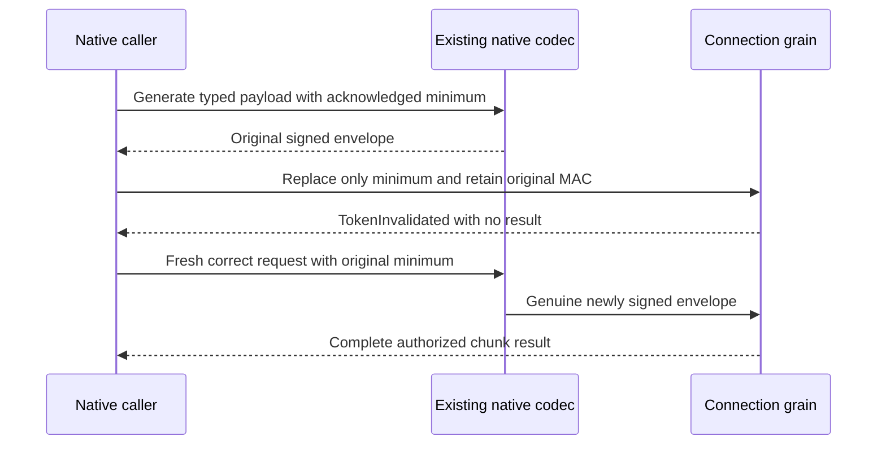

# Signed native chunk minimum boundary

Extends [ExplicitChunkMinimumConsistency](ExplicitChunkMinimumConsistency.md), AC-SERIES-CHUNK-010/011/012 and ADR-125. The nullable request MinimumToken remains stable generated Orleans Id7 inside the signed native payload.

REQ-SERIES-CHUNK-MINIMUM-SIGNATURE-001: native generated serialization carries the complete optional minimum inside the original SampleChunkWindow read payload and database-signed GrainRequestEnvelope. Replacing only that minimum after signature issuance, retaining original envelope metadata and original MAC, must return TokenInvalidated and no payload. Removing the minimum and substituting a different genuine acknowledged minimum are both tested; neither change is inherently an invalid read, so MAC refusal cannot be inferred from a semantic minimum error.

AC-SERIES-CHUNK-MINIMUM-SIGNATURE-001: one genuine native connection executes complete independent chunk rows, both post-MAC tamper refusals followed unconditionally by freshly codec-signed healthy reads, fresh persisted SeriesRead revoke/repair, original full receipts and replay, then two joined same-directory cold storage owners. Every read/refusal/replay conserves complete raw bytes, native position and identity under a failure ledger. Opaque cuts are never compared with token prefixes. Cold checks use the genuine fresh native codec and real stored reader after the connection and silos join; they do not claim a restarted network session or RF3.

The fixture opt-in selects existing native ordered TestDatabase admission and existing RequestCqrsNativeCommitCoordinator. All existing callers retain original default execution and lifetimes. No dispatcher, cryptographic implementation, trusted role, serializer alias, timeout increase or library is added. Compiler, whole operation, Linux/RF3 and performance qualification remain separate gates.

