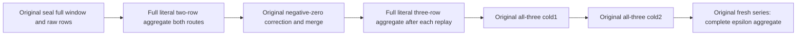

# Exact subnormal whole-operation aggregates

Canonical slice: TimeSeries. This strengthens the original PublicSubnormalSampleFidelity Case under REQ-SERIES-004/017 and AC-CHUNK-002, REQ/AC-SERIES-CHUNK-007/010/012; it adds no declaration, arguments, UID, fixture, deadline, provider or format.

| Requirement | Acceptance and original automated owner |
|---|---|
| REQ-SERIES-SUBNORMAL-AGGREGATE-001 | AC-SERIES-SUBNORMAL-AGGREGATE-001: after explicit seal the independent complete aggregate is count2,sum+0,min−double.Epsilon,max+double.Epsilon,average+0. After the original negative-zero correction and merge it is count3 with the same other four fields. Both actual SDK and official MCP return the full five-field record; explicit IEEE bit comparisons retain zero sign and all finite values. |
| REQ-SERIES-SUBNORMAL-AGGREGATE-002 | AC-SERIES-SUBNORMAL-AGGREGATE-002: each added aggregate response is immediately followed by the unchanged full window and four-route raw oracle. Every original command replay and both joined all-three cold cycles repeat the aggregate through the existing Current callback. No query effects or private raw image/receipt-to-local-cut correlation are newly claimed. |
| REQ-SERIES-SUBNORMAL-AGGREGATE-003 | AC-SERIES-SUBNORMAL-AGGREGATE-003: the original fresh independent healthy series has count1,sum/min/max/average exactly double.Epsilon; each response is bracketed by its unchanged full literal raw result. Old merged records, original full receipts and fresh receipt replay remain intact. |

Original automated Case: SampleChunkSubnormalClusterTests.AcSeriesPublicSubnormal001004SealMergeReplayAndTwoColdKeepExactPublicSamples. Existing Results role adds the feature-local SubnormalWholeAggregateClusterOracle. Existing Seed/State/Receipts/Replay/Callers/Cold/Flow/Case remain byte-exact. Backend/SDK/MCP production, frontend, persistence and benchmark changes: N/A, acceptance-only extension of existing operations. No new library or SIMD execution switch.

Source audit: the current chunk numeric encoder/decoder uses lossless per-record XOR/varint IEEE representation, not a vector-width transform. Existing codec tests already roundtrip every count1..256; no invented SIMD block/tail boundary or confirmed producer defect is claimed. The real aggregate owner calls published ManagedCode.TimeSeries.DoubleTimeSeriesSummer for sum/min/max. Its normal required SIMD implementation remains independently owned; source review here neither changes nor qualifies its SIMD/numerical implementation. Any confirmed dependency defect must be repaired and delivered in its owning sibling repository under the mandatory single batched release policy, never hidden by a consumer normalization/fallback.

The full operation assertion source is integrated after preview and independent whole-source review. The cluster operation still requires execution. Original deadline fit, actual cluster/Linux execution and numerical/SIMD performance qualification remain OPEN. The independent literal oracle is not derived from returned aggregate output or an alternative library fold.

ADR: N/A for this acceptance-only extension of existing public aggregates; storage, SIMD provider, authority and cluster contracts remain unchanged.

