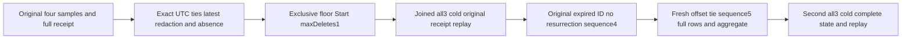

# TimeSeries UTC ties, retention floor and complete public results

Accepted existing REQ-SERIES-003/005/014/015, AC-SERIES-005/014/015 and AC-MP-005 govern this source-only refinement. The existing execution `TimeSeriesClusterReadTests.AcSeries008LatestUsesTimestampThenSequenceAndReturnsTypedAbsence` retains its declaration and identity. Its original early/tie-first/tie-last/later samples, tie-last sequence3, projected private tags, SDK/official MCP latest and typed absence remain mandatory. No additional test declaration, dependency, product format, public API, bounds, clock, timeout, provider or SIMD mode is introduced.

REQ-SERIES-UTC-PUBLIC-001: the complete independent SDK and official MCP sample results preserve event identity, exact original offset/timestamp, IEEE value, persisted sequence, series and authorized tags for equal UTC timestamps. The append stores the original SampleData; UTC/sequence keys determine ordering, without replacing the original offset.

AC-SERIES-UTC-PUBLIC-001: seed exact original early(-3), tie-first(4), tie-last(6,+02 offset), later(12) values at sequences1/2/3/4. Compare complete ordered four-row JSON, complete LatestSampleResult at an equivalent -05 offset cutoff, complete absent empty-series result, exact independent aggregate4/19/-3/12/4.75, complete retention null/0/false, and administrator's full private tags through both clients. Every original complete receipt must bind the logical atomic partition, positive position, ProcessDurable and complete independent mutation; replay must preserve its complete original bytes and bracket the full current public state/outbox.

REQ-SERIES-UTC-PUBLIC-002: expiry is exclusive below the declared UTC floor, including equal-timestamp rows with different offsets. Retained sample IDs continue to deduplicate after purge; reusing the old ID must not resurrect a below-floor row or increase the next fresh sequence.

AC-SERIES-UTC-PUBLIC-002: a genuine Expire at the tie UTC floor deletes only early and returns exact cumulative1/HasMore=false. Keep tie-first2, tie-last3 and later4 in full ordered results, exact aggregate3/22/4/12/(22/3), full latest at the original cutoff and typed absence below floor. Join all three owned nodes and reopen fresh caller scopes. A fresh outer command containing the original expired early ID returns append sequence4 without restoring its row. A distinct fresh sample at the same floor with -03 offset/value8 obtains sequence5 and becomes latest at the tie cutoff, while range order is tie-first2/tie-last3/fresh5/later4 and aggregate4/30/4/12/7.5. Preserve all original complete receipts and projected/private state during replay. A second joined all-three cold cycle retains all full literal results and every receipt.

Canonical map: existing Cases/TimeSeriesClusterReadTests.cs changes only the existing latest case to the feature-owned full flow; new Models/SeriesUtcTiePublicState.cs owns fixture state, Helpers/SeriesUtcTiePublicSeed.cs owns genuine immutable commands, Assertions/SeriesUtcTiePublicAssertions.cs owns complete independently literal values, Helpers/SeriesUtcTiePublicObservation.cs owns public/replay brackets, Helpers/SeriesUtcTiePublicTrial.cs owns phase ordering and Helpers/SeriesUtcTiePublicCold.cs owns actual original node shutdown/restart joins. Documentation is docs/Features/TimeSeries/UtcTieRetentionPublic.md. UI, new SDK/server/core APIs and new packages: N/A because existing APIs implement this accepted contract.

Public full DTO/outbox observations are scoped evidence, not a raw global journal/file image. Successful new commands can legitimately advance committed metadata. Cold restart is local development/process evidence only; original exact-source Linux build, complete TUnit, recovery, cluster, fault/endurance/resource and measured performance gates remain OPEN. Compiler discovery and runtime counts cannot be inferred from source. No acceptance is credited until Main integrates and executes the complete original test.

The existing case owns its original McpCallerDeadline.Create lifetime and passes its Token through the entire joined flow. The deadline links TestContext.Current.Execution.CancellationToken; no new timeout or cancellation owner is introduced.
