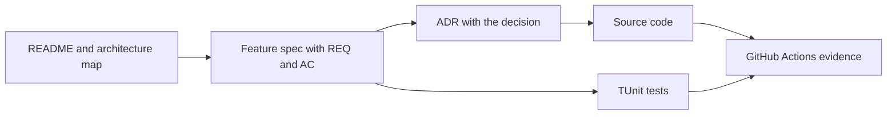

# KeyLoad documentation

KeyLoad is one database for AI agents: documents, typed tables, graphs, blobs, queues, events, search and time series live in one database and reference one another. SQL is the shared language for combining them; the .NET SDK and the built-in MCP server reach the same authorized operations.

The cluster is Microsoft Orleans. Orleans does membership, placement, activation migration, communication between silos and scaling, and data is copied to replicas through ordinary Orleans calls. Every silo has its own ZoneTree that owns its files. A public request goes to one Orleans grain per connected client, which calls the ZoneTree owner on its own node or on other nodes, gathers the results and returns them. See [ADR-136](ADR/ADR-136-orleans-partition-ownership.md).

Start with the [architecture map](Architecture.md). The [product specification](design/product-specification.md) describes the whole product; the [repository rules](../AGENTS.md) take precedence.

## Data models

| Feature | Contract |
|---|---|
| [DatabaseComposition](Features/DatabaseComposition.md) | One database: queue → entity → graph and graph → queue derivations through SQL, SDK and MCP |
| [DocumentStorage](Features/DocumentStorage.md) | JSON CRUD, PATCH and CAS, strict scalar and unique indexes, atomic batches and persisted command outcomes |
| [RelationalStorage](Features/RelationalStorage.md) | Typed rows in canonical entity storage with primary key, type, null and unique constraints |
| [EventStreams](Features/EventStreams.md) | Expected-revision append, EventId deduplication and ordered replay |
| [Messaging](Features/Messaging.md) | Durable queues, scheduled and leased work, fenced ACK/NACK/renew, inbox, topics and consumer groups |
| [GraphTraversal](Features/GraphTraversal.md) | Atomic edges and adjacency, bounded directed traversal and shortest paths |
| [TimeSeries](Features/TimeSeries.md) | Samples, bounded ranges, aggregates, retention, rollups and chunks |
| [Search](Features/Search.md) | Exact vectors, full-text (ZoneTree.FullTextSearch), ANN and hybrid search under the same authorization |
| [BlobStorage](Features/BlobStorage.md) | Chunked blobs with partial reads |
| [AnalyticsStore](Features/AnalyticsStore.md) | User analytics events on ZoneTree.Analytics |
| [ChangeFeeds](Features/ChangeFeeds.md) | Atomic outbox, resumable change feeds and projection checkpoints |
| [QueryExecution](Features/QueryExecution.md) | T-SQL through ScriptDOM, one authorized query AST, budgets, Explain and cursors |

## Cluster, callers and platform

| Feature | Contract |
|---|---|
| [OrleansExecution](Features/OrleansExecution.md) | Orleans does all clustering: one grain per connection, partition grains, calls to the silo-local ZoneTree owner on any node, stateless workers for background work |
| [StorageReplication](Features/StorageReplication.md) | Copies through Orleans Grain Service calls to `ReplicaCount` silos found through membership, acknowledgement from every configured copy, catch-up through Orleans |
| [StorageRecovery](Features/StorageRecovery.md) | The silo-local ZoneTree owner: stores, journals, locks, ordered apply, read lifetimes and process recovery |
| [BackupRestore](Features/BackupRestore.md) | Verified backup of a node's ZoneTree files and clean-target restore |
| [InternalSerialization](Features/InternalSerialization.md) | Generated Orleans serialization and the current internal binary formats |
| [Authorization](Features/Authorization.md) | Persisted credentials and grants, row and field policy, policy epochs |
| [ClientApi](Features/ClientApi.md) | .NET SDK, CLI and the official MCP server with on-demand tool discovery |
| [AdminDashboard](Features/AdminDashboard.md) | Read-only admin console |
| [ResourceExecution](Features/ResourceExecution.md) | Per-operation data bounds, memory, resource lifetimes and telemetry; no request throttling |
| [CodeQuality](Features/CodeQuality.md) | Analyzers, formatting, maintainability limits and functional coverage |
| [TestInfrastructure](Features/TestInfrastructure.md) | TUnit with Aspire-owned Docker clusters, real .NET SDK and official MCP clients |
| [BenchmarkComparisons](Features/BenchmarkComparisons.md) | One shared dataset and scenario per data type, one Benchmarks job per database, type and node count; published figures only from those jobs' result files |
| [ReleaseDelivery](Features/ReleaseDelivery.md) | The Build and Tests, Benchmarks, Website and Release workflows |
| [RepositoryGovernance](Features/RepositoryGovernance.md) | Repository rules, local ownership and REQ/AC/ADR traceability |

## Decisions and status

- [ADR index](ADR/README.md): every architecture decision. *Accepted* means the decision is in force; implementation and qualification are tracked in the feature specs.
- [Current status](implementation/status.json): a short record of the product state and the open qualification gates.
- [Durability audit](implementation/durability-audit.md) and [benchmark principles](implementation/comparative-benchmarks.md).
- Designs: [Q1 queries](design/query-q1.md), [bounded reads](design/bounded-reads.md), [change feeds](design/change-feeds.md).

Qualification evidence comes only from GitHub Actions runs and their original artifacts for the exact source. A document review proves no speed, power-loss durability, coverage or production readiness.
