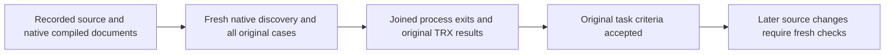

# KL-035 and KL-079 recorded-source acceptance

The original task criteria in [architecture-v0.3](../design/architecture-v0.3.uk.md) are accepted for source `b1f57eb8d487270983b428d835c922701dd14ed7`, Linux [Build and Tests run38141392779](https://github.com/managedcode/KeyLoad/actions/runs/38141392779). Both task jobs completed successfully. KL-035 remains accepted. KL-079 was reopened after the subsequent observed regression below; the original B1 acceptance is retained as historical evidence. These results do not qualify later joined source, the complete product, functional coverage, performance, endurance or power-loss durability.

| Task | Successful job | Original artifact | Unit | Real process recovery | Aspire Docker RF3 | Total |
|---|---|---|---|---|---|---|
| KL-035 | [114475823187](https://github.com/managedcode/KeyLoad/actions/runs/38141392779/job/114475823187) | [11703094406](https://github.com/managedcode/KeyLoad/actions/runs/38141392779/artifacts/11703094406) | 1 | 46 | 2 | **49/49 PASS** |
| KL-079 | [114475823404](https://github.com/managedcode/KeyLoad/actions/runs/38141392779/job/114475823404) | [11703682407](https://github.com/managedcode/KeyLoad/actions/runs/38141392779/artifacts/11703682407) | 36 | 7 | 5 | **48/48 PASS** |

No selected case failed, skipped or lacked its native identity. The active profile uses SIMD normally; the retired hardware-intrinsics-disabled profile is not an active acceptance prerequisite.

## Original criteria and traceability

| Original criterion | Existing requirement / acceptance | Actual passing operation evidence |
|---|---|---|
| KL-035 empty-disk follower catches up | REQ/AC-REP-004; snapshot-install contract | `ErasedFollowerInstallsNativeSnapshotAndOrderedTailBeforeCompletePublicReplayAndHealthyContinuation`: verified install, strictly later ordered tail, complete .NET/official-MCP output and immutable replay, same-root cold continuation. Retained-follower case preserves prior outcomes. |
| KL-035 interrupted install recovers | REQ/AC-REP-004; storage-recovery cut contract | All46 original snapshot, metadata, term, transfer, install and process-cut cases; complete verified canonical state or explicit rejection, joined original child processes and unchanged original assertions. |
| KL-035 log GC preserves the last recovery path | REQ/AC-REP-004; snapshot-prefix retention contract | Original prefix reclamation/snapshot recovery cases in `snapshot-install-recovery-and-gc`, plus retained-follower catch-up with stable command outcomes. |
| KL-079 reconnect loses no retained committed changes | REQ/AC-FEED-002/003/005 | `OriginalCursorReconnectsAcrossColdRf3AndRechecksRevokedPersistedAccess`, bounded initial-snapshot/tail live-query oracles, retained/empty-follower and leader-loss paths. |
| KL-079 duplicates are documented and idempotent | REQ/AC-FEED-001/003/004 | Full original command/effect receipt replay, failed-batch no partial outbox/checkpoint, scalar live-delta differential and seven real projection process-cut cases; delivery remains at least once with idempotent effects. |
| KL-079 old subscription retains no revoked grant | REQ/AC-FEED-002/005 | Original public RF3 cursor/policy repair flow and original policy/ACL/incarnation, former-owner and stale-cursor negative tests; persisted authority rechecked before every read. |
| KL-079 feed returns no raw PII | REQ/AC-FEED-002 | `FeedResumesAnEmptyTailProjectsPiiAndRetainsDeletionMetadata` and the original SDK/official-MCP document/live-feed complete projection oracles, including post-revocation and cold paths. |

The [ChangeFeeds](../Features/ChangeFeeds.md), [ClusterReplication](../Features/ClusterReplication.md) and existing snapshot/recovery contracts retain broader pending work. Cross-partition subscription merging, richer live-query profiles, external-index publication and production gates are separate requirements, not advertised as delivered by these two original bounded tasks.

## Closed original selection inventory

| Task | Original selection | Native cases | Result |
|---|---|---|---|
| KL-035 | `native-snapshot-contract` | 1 | PASS |
| KL-035 | `snapshot-install-recovery-and-gc` | 46 | PASS |
| KL-035 | `empty-follower-sdk-mcp` | 1 | PASS |
| KL-035 | `retained-follower-sdk` | 1 | PASS |
| KL-079 | `unit-change-feed-tests` | 7 | PASS |
| KL-079 | `unit-change-feed-read-tests` | 6 | PASS |
| KL-079 | `unit-change-feed-observed-work-tests` | 2 | PASS |
| KL-079 | `unit-native-change-feed-cursor-tests` | 1 | PASS |
| KL-079 | `unit-projection-progress-tests` | 7 | PASS |
| KL-079 | `unit-projection-read-work-tests` | 1 | PASS |
| KL-079 | `unit-outbox-purge-tests` | 5 | PASS |
| KL-079 | `unit-live-query-tests` | 6 | PASS |
| KL-079 | `unit-live-query-result-composition-tests` | 1 | PASS |
| KL-079 | `recovery-projection-process-recovery-tests` | 7 | PASS |
| KL-079 | `rf3-feed-live-rf3-tests` | 2 | PASS |
| KL-079 | `rf3-empty-replica-snapshot-rf3-tests` | 1 | PASS |
| KL-079 | `rf3-leader-loss-projection` | 1 | PASS |
| KL-079 | `rf3-retained-follower-projection` | 1 | PASS |

## Provenance and original artifacts

The independent observer verified every referenced original length/SHA (45 for KL-035,135 for KL-079), exact native case/declaration/UID inventory, unique original TRX test IDs and PASS results, before/after compiled image identities, complete native source/PDB binding, and successful source-verification/discovery/execution exits. Every original process observation joined its exit and both output readers and reported disposal. Receipts and original artifacts were not rewritten. The contract referenced outside the ZIP was independently matched to exact repository bytes and the recorded source's Git blob (`455958`bytes, SHA256 `a2962ead4543691b7697b7b65a977c72c41f5b1131fe63eb0e35b9e15cb81910`).

| Task | Original ZIP SHA256 | Acceptance receipt SHA256 | Execution manifest SHA256 |
|---|---|---|---|
| KL-035 | `ced2aa3050bf23c329bd45c239affd0f1d27e431f72f1e99485294257c429180` | `236ff9bfe8374120afe816417df76b310f7a46419488d167e6e30c085c848d68` | `a9bbc309667ea88ea093ccec8fb69064390a5cf37d1fd179349fe65ceb2992f1` |
| KL-079 | `829806a66d83b94100e62229e11107e65be26752c734907eec8f8c354f39f868` | `9899f851994ebed022a72799d52e5f7e0cc6906d87f0ec93e1bbd85a2d211fbc` | `a6933beec5b24bfe044ae3264202d5985061436cbae7164cef25b827183f9623` |

Observer SHA256: `8ffbd9d69afb36a5ef75d53c07793bc7b3b6d312f45116bfb8e946025c316a22`. Current status points to this durable crosswalk and the original GitHub jobs/artifacts; earlier failures and partial development stages remain historical evidence. No private or current-source runtime PASS was substituted for these authenticated Linux results.

## Subsequent live-page regression: KL-079 reopened

Linux [run38143183124/job114481041255](https://github.com/managedcode/KeyLoad/actions/runs/38143183124/job/114481041255), source `8e4cadd03d6547f05ac6904f7c7faf7765762e27`, passed the original reconnect/cold case but failed `ConcurrentSnapshotAndCommittedTailRemainGapFreePrivateAndRevocable` at the complete `LiveQueryPage` byte oracle. The original log is155335bytes, SHA256 `9659192b5d1c92a39d60358a850a0371c98c73aab3bc3de0ffe72dd92f1853f6`. The first failure is distinct from later Aspire cleanup messages. No cause, relaxed assertion or repair success is inferred. KL-079 is again in progress until causal repair preserves the full page, cursor, fence, retry, privacy, original deadline and owned RF3 lifecycle and the complete original48-case Linux lane succeeds. The original B1 job, ZIP, receipts and all48 PASS observations above remain immutable. Current plan:18 accepted,86 in progress.

## Subsequent fc4 snapshot regression: KL-035 reopened

Linux [run38154439586/job114514387807](https://github.com/managedcode/KeyLoad/actions/runs/38154439586/job/114514387807), source `fc4e490e66ff20d3c6e5e2891883ecb698ba99bc`, executed all49 original cases:48 passed and the empty-follower SDK/MCP scenario failed after73.381seconds because the expected ordered tail entry was absent. The original observation records installed snapshot80, later snapshot96, committed/applied/tail position96 and no retained entry at that position. It does not establish the initiating cause. Later Aspire cleanup messages are separate. No tail assertion, deadline, retention or task gate is waived.

The original authenticated [artifact11707669002](https://github.com/managedcode/KeyLoad/actions/runs/38154439586/artifacts/11707669002) has ZIP SHA256 `304fce5cf6b2838179973eeae8322b54804e1a61749619e28c92ed0d3321bc68`. Every original CLI UID, native JSON ID, TRX instance and source/image observation is bound in the49-case observer, SHA256 `7c35910aa74e8055f410063d7e7c0a0308d7248c87c35aa30ab258e32c6ecbef`. The independent root intake has SHA256 `736e630edc5f3969ce925ed36df0aa7026759325bac6021bec31dd9926d30b5b`.

KL-035 is in progress until a causal repair preserves the original snapshot/ordered-tail, retention, canonical outcomes and joined RF3 lifecycle and all49 original Linux cases pass on the delivered source. Historical B1 acceptance remains49/49. Current original104-task plan:17 accepted,87 in progress.
