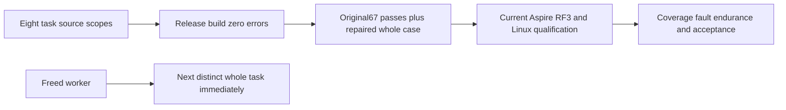

# Stage84: coherent eight-task operations

Status: local development checkpoint, 2026-10-15. **20/104 original tasks accepted, 84 in progress; additional KL-105 open.** No source packet, build or focused case is promoted to full acceptance.

## Joined implementation

The coherent 132-path task batch joins distributed source authority037, metadata bootstrap018, metadata-index matching049, partition-scoped time-series chunks078, genuine absent-record strong sessions021, early admission052, native text-provider audit028 and ANN-provider qualification030. Reviewed finite API, cancellation, lifecycle, coverage-registration and canonical literal repairs preserve persisted authorization, connection-owned Orleans execution, node-local ZoneTree and RF3. Metadata identity/revision no longer enter ordinary body-index matching.

The original078 fixture explicitly sealed an already automatically sealed historical window. The repair separates the two initial samples into native appends while retaining the exact2001 corpus/window, five mutations/outbox count, independently fixed five receipts, generation2/revision6/source3, offsets/negative-zero bits, retention/drop, current grants, original replays and both cold owners. Product revision preconditions and clock are unchanged. Existing explicit-seal lifecycle suites remain mandatory.

[ADR-133](../ADR/ADR-133-node-owned-kernel-clock-phase.md) and additive IO policy freeze the read-only observation/current-phase contract. This checkpoint joins **no native interop bodies or provider binding**. Executed matching Linux ABI, complete current callers and physical/scheduler qualification remain open.

## Original verification

| Scope | Actual result and boundary |
|---|---|
| R111 complete Release build |149 errors/0 warnings; original diagnostic ledger retained before repair |
| R113 formatter apply |36 source changes fully reviewed;33 identical nonimport token streams, two identical inferred integer values, one same field-backed property semantics |
| R114 repaired complete build |0 errors/0 warnings before final078 fixture correction |
| R118 final complete Release build |0 errors/0 warnings in 394.451s;0 source drift,20 regenerated DLL/PDB images |
| R119 full formatter verify |native exit0 in 266.443s;0 source/image drift |
| R116 related functional Unit |67 passed/1 failed/0 skipped of68 in 32.593s; native limit50 and actual TRX peak50 |
| R120 original failed whole operation |1 passed/0 failed/0 skipped in 10.175s; actual peak1,0 source/protected-image drift |
| Repository governance |PASS: preserved root prefix,27 projects,4 modules and required policies; static evidence only |

R116 failed at the invalid seed of SameWindowAndSampleIdentitiesStayPartitionScopedAfterRetentionDropReplayAndTwoCold before qualification assertions. R120 executes that same complete case after repair. The original67 passes remain separate: regenerated Clustering/test images mean these are **not one fresh68-case or complete current-suite pass**. Compiling public RF3 fixtures is not running them. Stage83 original failures and repaired reruns remain immutable history.

## Functional coverage

R116 recorded **10,804/108,294 lines (9.97655%)** and **5,464/68,667 branches (7.95724%)** for the selected68 functional operations including the failed seed. Load/benchmark tests contribute none. Original collector XML and generated entries remain intact. The source-owned gap work list excludes generated entries solely to prioritize meaningful operation tests, without changing reported denominators or thresholds. Different R97 source/cases are not a matched comparison. R120 coverage is retained separately. Full-product coverage gates remain open.

## Exact evidence

The parent is 1581732d4cf396276da95c613c07732e6839c333. The verification map contains 12775 source inputs; digest 1aebe3ba99d9d6ead51e9bd6f7f77e8ca131d08f4a07293afed2be7fdfd41ff5. The 318 DLL/PDB map digest is 3eac727d82f0701dcec1b971bef9df68b2834bbe25a00416c08d95180291d4dc. Subsequent publication changes only this record, status JSON and README. Original maps/stdout/stderr/TRX/Cobertura are retained under ignored TestResults/stage61-native-join; key hashes follow.

| Original artifact | SHA256 |
|---|---|
| R118 build stdout |73e7895d11f24fd32561c5f68e7811bc4968397a512b97582f585e9df8dec4e4 |
| R119 formatter stdout |e3b0c44298fc1c149afbf4c8996fb92427ae41e4649b934ca495991b7852b855 |
| R119 formatter stderr |e3b0c44298fc1c149afbf4c8996fb92427ae41e4649b934ca495991b7852b855 |
| R116 original TRX |ea81ccb30b75e0d484fcb6fa53d38d4e4c90bf7651521abca56515e980572d29 |
| R120 original TRX |9bdb76cce25caf52388cc95ef48498bc2265c45ad027a63ef3bf7fd1edfaec7e |
| R116 original Cobertura |a1b68fb19b4c91757b507f48b3a7b58d299bb35f1664dcc87442ebf49551e437 |

Independent Root full5 source review closed075 duplicate physical-container validation; that packet is **not joined or executed** here. Ready050/063/064/095/080/079/091/090/068/067/098 SourceN packets also remain outside delivered source pending guarded integration and original runtime gates.

## Ownership and remaining gates

Freed main workers immediately rotated075→080→047 and050→079→076 while092 continued and Root verified. Every predecessor retains its failure/acceptance owner. Further outgoing companion messaging was rejected by automatic approval for missing destination-specific permission; the explicit three-chat question remains pending. No rejected message was retried or bypassed; local code and incoming updates continue.

At the last observed parent snapshot, [Build and Tests38682414398](https://github.com/managedcode/KeyLoad/actions/runs/38682414398) had19 queued jobs, runner_id0 and no steps. Its cause is unknown. A later pushed checkpoint needs its own run; local evidence does not establish Linux execution.

Next gates: actual new whole-class RF3 selector/census/image admission; complete TUnit-owned Aspire startup, real membership, discovered SDK/official MCP operations and joined cleanup; complete Unit/recovery, delivered-source Linux, full coverage thresholds, fault/endurance and all original acceptance. KL105 has no qualified hotspot from its previous failed native capture. Native1/3-node100k/1m workloads with at least100k measured operations and matched competitor/resource/durability contracts remain Linux GitHub-only. No speed, physical accuracy, power-loss or production claim follows.

