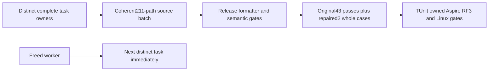

# Stage85: authorized model operations and native RF3 admission

Local development checkpoint, 2026-10-15. **20/104 original tasks accepted, 84 in progress; additional KL-105 open.** This record qualifies the stated development checks only.

## Integrated implementation

The batch integrating 211 paths joins eight distinct task scopes. Connection-owned Orleans execution, fresh persisted authorization, node-local ZoneTree/WAL/apply ownership, native SIMD and RF3 remain unchanged.

| Task | Joined behavior |
|---|---|
| KL-064 | Selected projections retain redaction provenance only from their contributing selected source fields; native/public source, patch, cursor and original-history flows retain exact canonical content. |
| KL-047 | Actual ScriptDOM lowering rejects unsupported collation in numeric, ordering, generation and INSERT expressions before executable admission; complete native/public SQL and AST flows remain. |
| KL-063 | Graph-search field-use and graph-read authorization precede expansion, ranking and lookup, including empty labels; full refusal, repair, original-result and cold flows remain. |
| KL-080 | Exact whole-class local-image admission includes the six new RF3 operation classes and their ordered union; original closed coverage contributor catalog is unchanged. |
| KL-075 | Native resource evidence rejects reuse of the same actual physical Docker container across declared owners. Comparison execution remains Linux-only. |
| KL-091 | Complete staged atomic document/event/queue images, rollback, current authority, receipts and two native/public cold histories. |
| KL-090 | Competing SDK/node2 and official-MCP/node3 inbox processing retain equivalent/different recipe, fresh-policy, complete result/outbox/replay/cold assertions. |
| KL-095 | Active leased and ready sibling queue views preserve masked current authority and original history across renew, acknowledgement, healthy work and cold reopen. |

Shared fixture failure-root retention is opt-in and defaults off. Only already-eligible successful cleanup is deferred; startup/body/cleanup failures retain original evidence. Cleanup, native coverage and joined resource obligations remain mandatory.

The original two failed unit cases exposed fixture expectations: PATCH content is canonically ordered, and masked model JSON escapes the date offset through its actual JSON-node path. Independent literal goldens now match those existing contracts. Initial raw PUT bytes remain exact. Public queue-row equality now includes the actual complete JSON rather than replacing it with expected JSON. Complete comparisons use Boolean-only failure presentation to prevent a privacy regression from printing protected results. No production clock, permission or revision rule changes.

## Original verification

| Check | Actual result |
|---|---|
| R133 initial complete Release |0 errors/0 warnings; later test/selector corrections required a new build. |
| R136/R137 coherent selector build and formatter |Both native exits0; original receipts retained before later fixture repairs. |
| R140 related native Unit |43 passed/2 failed/0 skipped of45 in18.327s; configured50, original TRX interval peak45. |
| R141 native fixture controls |14 passed/0 failed/0 skipped; no database topology started. |
| R144 complete Release after initial repairs |0 errors/0 warnings; safe assertion-presentation correction followed. |
| R147 final complete Release |0 errors/0 warnings in1184.219s. |
| R148 final full formatter verify |Native exit0 in1165.841s; no formatting edits. |
| R150 semantic diagnostics |Ready27/27, errors0/warnings0;58025 informational and8315 hidden diagnostics are not promoted to a zero-all-diagnostics claim. |
| R145 original failed whole cases |2 passed/0 failed/0 skipped in10.751s; native limit50, actual TRX interval peak2. |

The final build/formatter source map has zero drift and20 regenerated DLL/PDB copies. R145 has zero source/image drift. The original43 passes and repaired2-case run remain separate; this is **not a fresh45-case or complete current-suite pass**. Original failures are retained. The formatter completed naturally before a proposed resource-related signal; no signal was delivered and no rerun is claimed. A bounded host observation recorded32GiB RAM, warning-level memory pressure and approximately35GiB swap during the slow checks; it proves no product performance result.

## Native RF3 boundary

Actual native metadata discovers10 cases in six complete classes: SafeProjectorOperationRf3Tests, SqlParserAdmissionRf3WholeFlowTests, GraphSearchLineageRf3Tests, AtomicTriadStagedRf3Tests, CompetingInboxPublicTests and QueueViewLeaseIsolationTests. Their exact ordered union is admitted by the real native selector. Metadata and preparation controls do not prove startup.

At this checkpoint the current10-case run has **not yet started**. The next run must let the TUnit session own the actual Aspire AppHost image prerequisite, three Docker nodes, readiness, discovered SDK/official-MCP operations and joined shutdown. Existing native scheduling for shared/cold resources remains; configured50 does not establish50 simultaneous RF3 operations. The closed11-case coverage contributor inventory is not widened by this selection.

## Functional coverage and source identity

R140 selected functional coverage, including its two original failures, is **8829/106910 lines (8.25835%)** and **5030/67793 branches (7.41965%)**. R145 separately records6896/106910 lines and3646/67793 branches for only the two repaired complete cases. Do not combine reports or compare different selected cohorts as a coverage regression. Load, stress, benchmark and comparison runs contribute none. Full-product coverage, matched CRAP and threshold qualification remain open.

The parent is 9942ca467b5e45337a886428a8302bfd117799db. The final verification map contains12968 source inputs and318 DLL/PDB inputs. Source map digest: 7860e68341d7bb168d24df9f455997cfe9f03bb49d551f4347912b16f7f1db26. Image map digest: d53b286bf9e29236d2295d09d50b145af7f22f336b84aeecad26f548c1aefcd0. Map digests use SHA256 over UTF8 JSON with sorted keys and compact separators. Publication subsequently changes only this record, status JSON and README.

| Original artifact | SHA256 |
|---|---|
| R147 build stdout |d2e38b49e0f0cbcb0f4c0ca3d03e0e6e9482650c8be9f443ee2cfad128bb3a88 |
| R148 formatter stdout/stderr |e3b0c44298fc1c149afbf4c8996fb92427ae41e4649b934ca495991b7852b855 |
| R140 original TRX |9228955b6fb6c26e64f9723bd82d488eb2de9a265df876dff6dff6ada575dda0 |
| R141 original14-control TRX |20f7c3e3d8645cf562a443f014fb5586df113d582444352d3dc2c00e4ef9987a |
| R145 repaired original2 TRX |0581e88eb77b777e09d1817f464d57e421a80319abe71250bb1b04d4a1ad2cc2 |

Original maps/stdout/stderr/TRX/Cobertura/native metadata remain under ignored TestResults/stage61-native-join. Other SourceN packets are outside delivered source and runtime qualification.

## Ownership and open gates

Freed main workers immediately took new distinct tasks:006→052→062→101→035;085→076→079→038→039→086;050→067. Every prior task retains its failure/acceptance owner. They write independently while Root integrates and tests. Further outgoing companion messages remain blocked by automatic approval pending explicit destination-specific human permission; incoming updates and independent work continue.

The last observed parent [Build and Tests38688461200](https://github.com/managedcode/KeyLoad/actions/runs/38688461200) had queued Linux jobs with runner_id0 and no steps; the cause is unknown. Parent [Benchmarks38688461184](https://github.com/managedcode/KeyLoad/actions/runs/38688461184) was pending. This checkpoint needs its own delivered-source runs; no queued job counts as passing.

Current full Unit/process-recovery, actual Aspire RF3 SDK/MCP, delivered-source Linux, complete coverage, fault/endurance and every original acceptance gate remain mandatory. KL105 has no qualified hotspot from its failed native capture. Read-only native clock bodies/provider bindings are not joined here. Competitor1/3-node100k/1m workloads with at least100k measured operations remain isolated Linux GitHub qualification. No speed, physical accuracy, power-loss or production-readiness claim follows.

