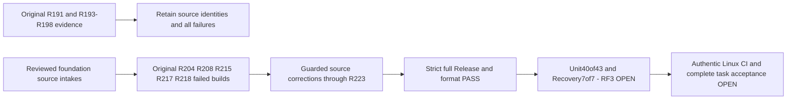

# Stage88: Native foundation intake and qualification boundary

Original-task status remains **20 accepted /85 in progress of105**. No task is promoted by this checkpoint. The [foundation-first plan](../Features/RepositoryGovernance/FoundationDelivery.md) stays canonical: Orleans/node-local storage, startup, recovery, telemetry and admission precede broader model work, final profiling, benchmarks and release.

The reviewed foundation intakes now pass the **R233 strict full Release build with0 warnings/errors** and **R236 canonical formatter verification**. The current original selected run executed **43 functional Unit cases:40 passed,3 failed,0 skipped** and **7 real-process Recovery cases:7 passed,0 failed/skipped**. All owned processes joined; source and test binary drift were empty. The three Unit failures are the revoke/expire/cancel variants of StartedReadPolicyTests at the first complete Started-frame JSON oracle. Their source-confirmed native event-type normalization correction is prepared separately and is not credited as executed here.

The published **ZoneTree.Analytics1.0.0** package was genuinely retrieved, its original MIT license and native ZoneTree2.0.1/net10.0 dependency verified, centrally pinned and restored in R230. R233 compiles the real package dependency. Native analytics engine/test source remains separately prepared; it is not activated or runtime-qualified by these43/7 tests. Production sampling stays behind the existing actual kernel/scheduler and joined-lifecycle integration gates.

## Source intake

- R201 joins the coherent nativeStorage82 batch: original captured/live read cancellation; required archive entry and conservative staging ownership; native metadata admission; invalid native value-marker refusal; architecture-correct retained regular-file flags and genuine write-through journal opening; snapshot manifest/published-image admission and complete protocol-failure conservation. NativeErrors83a5 is composed once. The original R5 ownership protections remain in the selected R4 overlay; Linux ARM64 O_NOFOLLOW0x8000 and x640x20000 are distinct. [ADR-135](../ADR/ADR-135-native-write-through-journal-admission.md) does not claim executed ABI, filesystem or power-loss proof.
- R202 joins46 smaller foundation paths: the original row caller budget starts after initial readiness and is not reset; R195 resolves actual native resource objects; the existing EventFeed provider is registered through the native silo; telemetry ancestry/projection, connection shutdown, sensitive-field output, held-read authority and independent policy repair retain their original public operation gates.
- R203 joins13 lifecycle paths retaining original builders, acquired applications, borrowed resources and failed-start evidence until actual original closure. R205 then joins the independently reviewed seven-path native log-binding batch. Restore CLI readers are created through the actual native before-resource-start event; TimeSeries readers resolve current-wave resources. These additions preserve original observation bounds, cancellation and joins.
- R207 overlays three existing paths after R204: ReplicaConsensus owns its explicit leader/snapshot/follower/lifetime disposal calls after the same original Stop settlement, while the helper retains the exact independent exception observer and single/aggregate rethrow. Source review and numeric preflight do not establish CA2213 closure; a successful full analyzer build is required.

- R211 supersedes the first disposal correction with direct ReplicaConsensus owner-field cleanup, the same original Stop/drain choreography in ReplicaShutdownStage and retained read-round error collection; the obsolete disposal helper is removed. The R202 intake contains the18-path native OTLP fixture/projection/selector union. R212 records a focused formatter application over134 paths that changed18 files. Formatter application is not successful compiler or current verify-no-changes evidence.
- R213 adds the10-path real-process snapshot-install fencing flow and ownership; R214 joins the three-path native metadata open-owner correction. Their complete native operation and cleanup gates remain pending current execution.
- R216 adopts the independently reviewed eight-path Linux native-clock prerequisite producer into the existing Build and Tests manual-input job, plus its feature navigation. Seven files are new and one existing workflow receives only its reviewed boolean/job delta. All original mandatory workflow jobs remain; no fifth workflow is added. Generated C# is artifact-only in that job. Neither C ABI probes nor native clock observations have executed in this record; runtime127/provider/callers remain held behind genuine evidence and separate integration.
- R219 joins nine selected storage Unit corrections; R220 joins the one-path client receipt private-getter reflection correction; R221 joins five authorization/connection-owner test corrections. Reflection of a client DTO preserves its existing boolean oracle but does not prove a native internal-storage privacy invariant. R223 joins the four-path OTLP resource-ownership correction: one Activity, one handler/client/receiver ownership chain and one fixture retain the original errors, tokens, limits and actual SDK/MCP workflow. These source repairs do not qualify their operations.

The R201/R202/R203 cohorts originally contained141 selected paths and R205 added seven distinct log paths. Later receipts include overlays, a deletion and additional fixture/tooling paths; their counts are not summed into an invented unique-source or accepted-task total. Each source intake retains its own exact guards, independent reviews and conditional dependency lineage. Actual adoption is established by Root receipts; prepared-only bodies are not silently included.

## Original local development evidence

| Original lane | Original result | Scope retained |
|---|---|---|
| R191 full Release | exit0;0 warnings;0 errors;331.984s | Original complete solution build; source drift0 |
| R193 focused functional Unit |124 passed;0 failed;0 skipped | Selected foundation operations only |
| R198 supplemental Unit |30 passed;0 failed;0 skipped | Original native journal authority, reserved wire and MCP catalog selection omitted from the earlier filter |
| R194 process recovery |7 passed;0 failed;0 skipped | Original selected real-process operations |
| R195 original migration RF3 |0 passed;1 failed;exit2;747.017s | Original cancellation while waiting in the native owner-registration observation path; repaired flow not executed by that run |
| R196 private/cold RF3 |3 passed;4 failed;0 skipped;exit2;1170.603s | Three Catalog revocation/demotion cases passed. Row put/patch/delete and SlowBody remained failed |
| R197 canonical formatter verification |exit0;515.844s | Original source only |
| R204 next full Release |exit1;0 warnings;4 CA2213 errors;77.875s | Original ReplicaConsensus field-disposal diagnostics; no current successful build |
| R208 owner-repaired full Release |exit1;0 warnings;7 errors;76.654s | Four IDE0200 lambda diagnostics and3 remaining CA2213 diagnostics; corrected full build still OPEN |
| R212 focused formatter application |exit0;74.002s;134-path scope;18 files changed | Applied formatting to that original scope; not current verification or compiler/runtime proof |
| R215 native foundation full Release |exit1;0 warnings;1 error;48.680s | CA1068: ReplicaShutdownStage cancellation token parameter order |
| R217 token-repaired full Release |exit1;0 warnings;2 errors;87.458s | SnapshotManifestEntryProbe KLD0035 numeric input and KLD0036 text input diagnostics |
| R218 crash-probe-repaired full Release |exit1;0 warnings;33 errors;213.170s | Actual Unit/Recovery/Integration API, ownership, cancellation, URI, platform and style diagnostics; full originals retained |
| R224 combined full Release |exit1;0 warnings;18 errors;350.169s | Original native ownership, Unix API reachability, Started factory argument and initialization diagnostics |
| R231 full Release plus genuine published Analytics dependency |exit1;0 warnings;1 CA2000 error;292.323s | Original retained-store ownership diagnostic; later lexical correction R232 |
| R233 current full Release |exit0;0 warnings;0 errors;699.057s | Complete current solution and actual package dependency; source drift0 |
| R236 current canonical formatter |exit0;367.073s | Whole solution verify-no-changes; source/binary drift0 |
| R209 current selected functional Unit |40 passed;3 failed;0 skipped;43 executed | All failures are original StartedReadPolicyTests frame-oracle variants; actual peak36 test intervals |
| R210 current process Recovery |7 passed;0 failed/skipped | Genuine native transfer/fencing cases; actual peak7 test intervals |

Each original process joined and both output files closed. Original R191 and R204 source cohorts had source drift0; their rebuilt DLL/PDB changes are not test results. The shared R193 original cohort and R198 supplement had source and compiled drift0. The configured native runner limit was50; it does not assert50 simultaneous RF3 clusters. These are local macOS/arm64 development receipts with fixture-owned native Orleans and Docker/Aspire where applicable, not delivered-source Linux qualification.

R195's source-confirmed string-versus-resource log lookup gap has a reviewed repair; the actual DCP key spelling was not observed. A source repair is not a successful migration or proof of exclusive runtime causality. R196 row failures occurred at different MCP/cold phases and do not prove one shared backend cause or that the relocated unchanged caller deadline now fits. SlowBody originally reported ResourceExhausted. All original failures remain preserved; the later selected corrections require complete original-operation reruns.

The R193 original selected124 functional Unit run measured **9082/107563 production lines (8.4434%) and4078/68298 branches (5.9709%)**. Its original Cobertura SHA256 is `27bc2e5ca41f5f532b5d38946de4c2ed3ee6427e4b60cf9bdc239b2d140f5d45`. No load tests were included. This is coverage for that one original selection only: **not full-product coverage, current-source coverage or a cross-source trend**. R198 is a separate supplement; counts must not fabricate a merged coverage result.

The [Stage87](qualification-stage87-foundation.md) and [Stage86](qualification-stage86-foundation.md) records remain history. Original ignored local receipts are retained under `TestResults/stage61-native-join/`: the exact `root-r191`, `root-r193` through `root-r198` completion/cohort/TRX records, `root-r204-foundation-integrated-release.*.original.*`, `root-r208-foundation-owner-repaired-release.*.original.*`, `root-r206-original-r193-functional-coverage.original.json`, and the R201/R202/R203/R205/R207 adoption receipts. The successor evidence index also binds the original R215/R217/R218 completion/stdout/stderr files, R211/R212/R213/R214/R216/R219/R220/R221/R223 source receipts and R222 governance/syntax-only checks. R222 does not execute Linux ABI/native observation. The SourceN checkpoint evidence index records their exact hashes; ignored local artifacts are not published CI evidence.

## Required continuation

| Next current-source gate | Terminal evidence to be filled by Root |
|---|---|
| Strict full solution Release | **PASS R233**;exit0;0 warnings/errors;699.057s; joined outputs and source drift0 |
| Fast functional Unit selection43 | **FAIL R209**;40 passed;3 failed;0 skipped; actual peak36. Full original failure evidence retained |
| Real-process Recovery selection7 | **PASS R210**;7 passed;0 failed/skipped; actual peak7; joined outputs and source/binary drift0 |
| Current canonical formatter verification | **PASS R236**;exit0;367.073s; source/binary drift0 |
| Original affected SDK/official MCP Aspire RF3 operations | **OPEN**; preserve R195/R196 failures until actual complete reruns |
| Linux mandatory suites and manual native-clock prerequisites | **OPEN**; requires pushed exact source, authenticated jobs/run/attempt/artifacts and actual native receipts |

These are exact local checkpoint outcomes. The failed three-case native frame oracle requires its complete original-operation rerun. The selected43/7 lanes do not replace the full mandatory suites or authenticate a Linux delivery.

The integration owner must supply a successful current full Release, canonical formatter result and original complete native Unit, real-process recovery and SDK/official MCP Docker/Aspire RF3 reports. Preserve original declarations, arguments, literal oracles, physical/source/image identities, operation budgets and joined resource cleanup. Do not transfer a prior pass to changed binaries or treat a targeted selection as a complete mandatory suite.

Native clock admission remains conditional on genuine matching Linux ABI/provider/current-caller/lifetime evidence; architecture-selected file flags do not qualify that separate gate. Full three-signal RF3 telemetry/export and final physical-disposal telemetry limits remain explicit. [ZoneTree.Analytics](../ADR/ADR-134-node-owned-derived-analytics.md) runtime adoption still awaits the expected genuine NuGet publication, with no invented version, local package or publication defect claim. No fresh package availability check is implied by this record.

Exact-source Linux full mandatory suites, fault/endurance, complete functional coverage, native clock and telemetry qualification, all remaining task criteria, matched diagnostic profiles, comparative measurements and release remain OPEN. No performance, power-loss durability or production-readiness claim follows from this checkpoint.

## Current selected coverage and package evidence

R209 selected43 functional Unit cases, including its three failures, measured **10167/107354 production lines (9.4705%) and4601/67943 branches (6.7719%)**. Original Cobertura SHA256: `22b0b9c5e8b6a650871d53b8b2b98f721b03e790e4ac22d6a41f33890a54815c`. This is one selected functional cohort, not full-product coverage or a trend against different selections. No load tests contribute. Original native results and concurrency/coverage census are retained in `root-r237-original-fast-tests-trx-coverage-census.original.json` under the evidence directory.

Published Analytics nupkg SHA256: `14254385f46a979ddbfee6c874833b4a3a5e754655bdc39b0525d99262370452`; repository commit: `f7511306bbf0c375a918fc8a93845b1f596777b7`. Its original MIT copyright/license is preserved in the server output/publish content. R228/R229/R230 records bind package verification, central reference and successful restore. Package publication is complete; normal engine activation and every native analytics operational gate remain open.

The R233 compiler spent699.057s in the complete build. A bounded diagnostics attempt saw a NativeAOT compiler with no macOS managed CPU backend; the process exited before a native stack/triage capture completed. No successful profile, measured hotspot, optimization or KL105 acceptance follows from that attempt.
